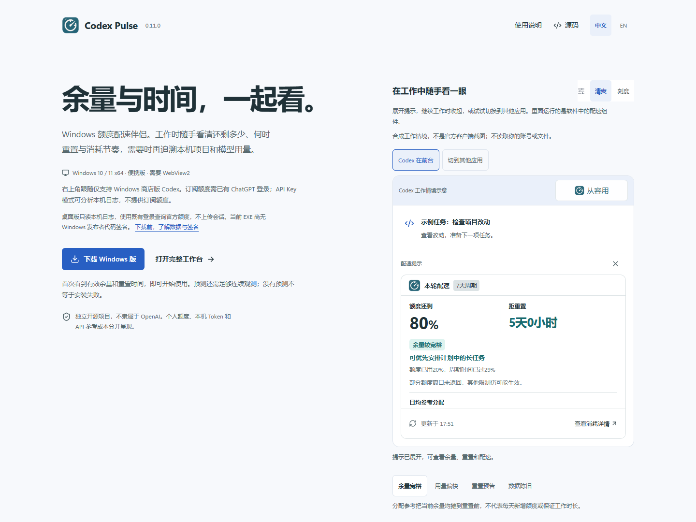
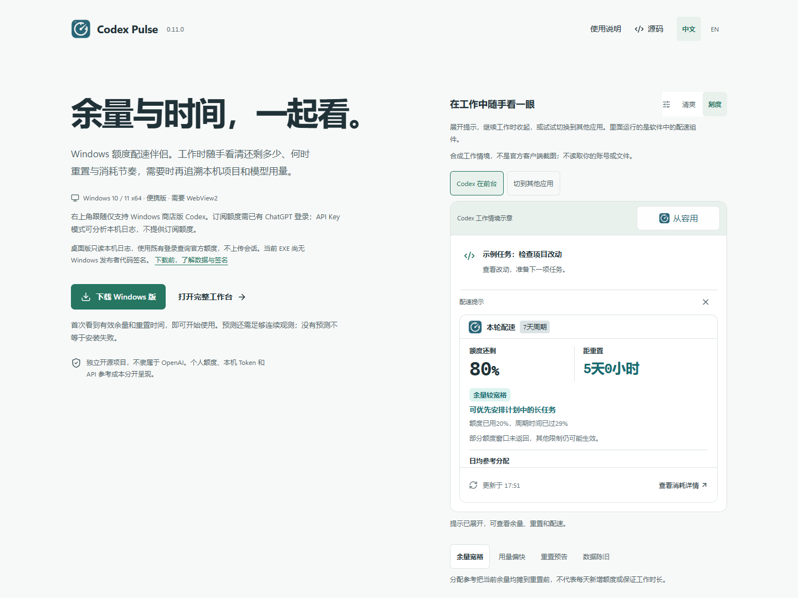
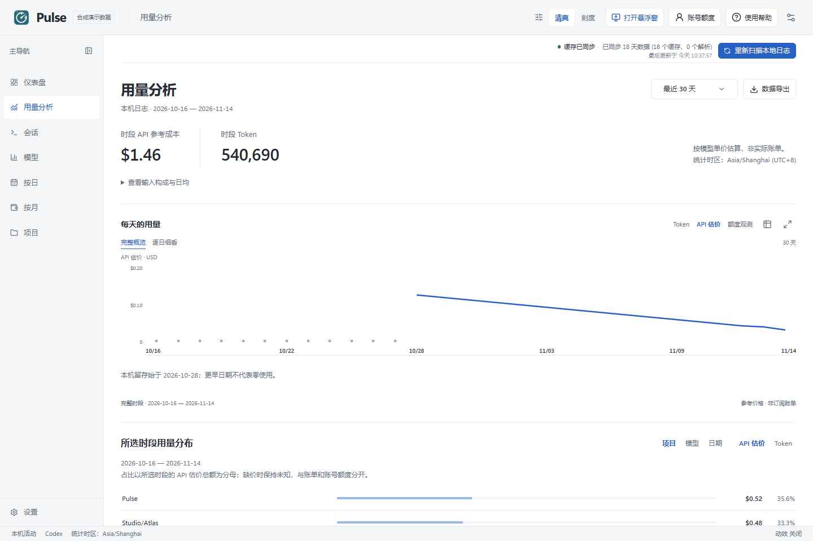
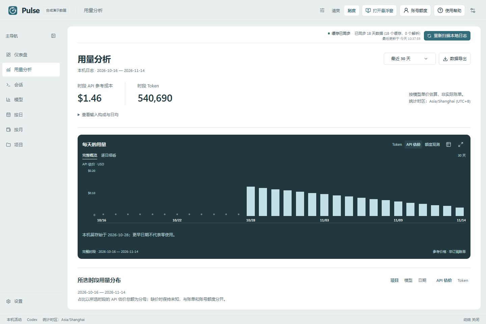
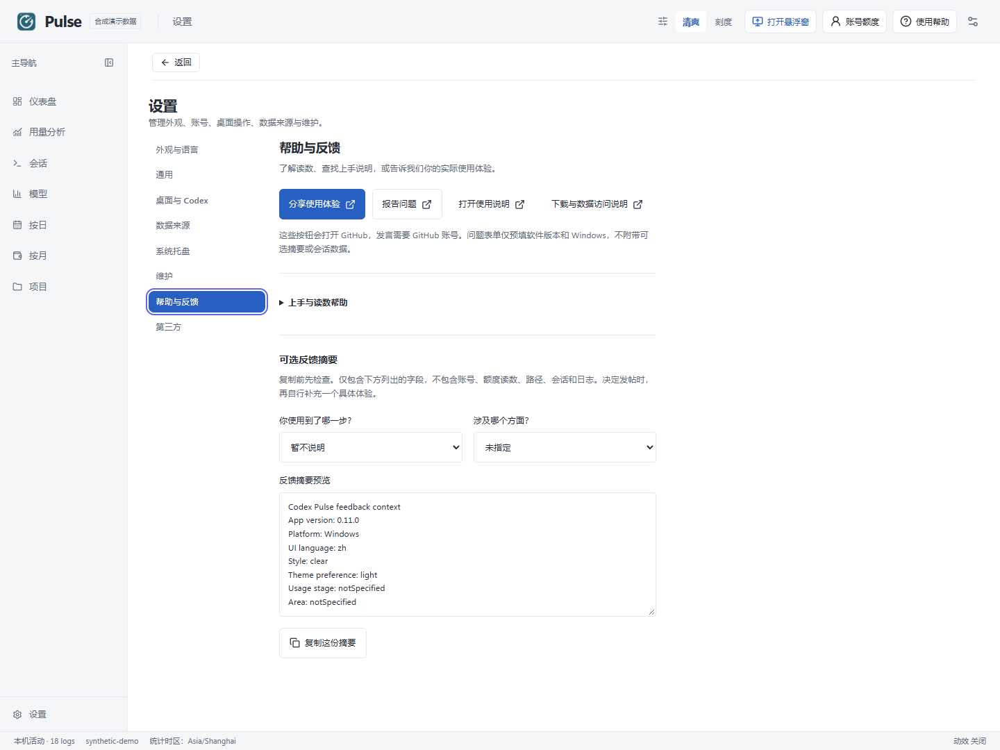
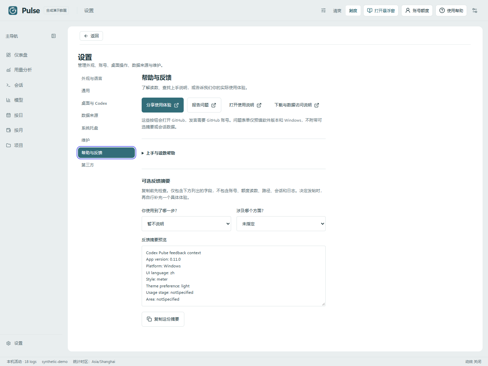

# Codex Pulse — A Windows Quota-Pacing Companion

A quiet quota-pacing companion for Codex on Windows: view remaining quota and reset time together, compare consumption with the window's time progress, and plan upcoming tasks. Includes **Clear** and **Meter**, a full usage workspace, and session replay.

**[简体中文](README.md)** · **[Download for Windows](https://github.com/zhulongqihan/codex-pulse/releases/latest)** · [Product and interactive preview](https://zhulongqihan.github.io/codex-pulse/) · [Full workspace demo](https://zhulongqihan.github.io/codex-pulse/?demo=1) · [Screenshots](https://zhulongqihan.github.io/codex-pulse/gallery.html) · [Issues](https://github.com/zhulongqihan/codex-pulse/issues)

> Independent open-source software, not affiliated with OpenAI. Public screenshots and browser demonstrations use synthetic data only.

**Before downloading:** the app requires Windows 10/11 x64 and WebView2. The corner-following indicator supports the Microsoft Store edition of Codex only. Subscription quota requires an existing Codex ChatGPT sign-in; API-key mode can use local analysis. The desktop app reads the existing sign-in locally to query official account services, reads local logs without changing them, and does not upload conversations. The current EXE has no Windows Authenticode publisher signature; Pulse's update-manifest signature is a separate mechanism. [Downloads, data access and signatures](docs/TRUST.md#english).

## Features

- **Shared quota pacing:** the corner card, desktop widget and workspace share remaining quota, personal reset time, plain-language advice and daily/hourly reference allocations. Basic readings do not depend on a depletion forecast, and accounts returning only a weekly window remain useful.
- **Smooth client shortcut:** a shared icon and compact status without a brand word. The input-free card follows verified Microsoft Store Codex windows through Windows location events, hiding when another app is active, Codex is minimized or space is insufficient.
- **Grounded extra indicators:** daily recorded changes and coverage in this cycle, a surplus-near-reset hint, and conditional remaining-at-reset ranges when sufficient observations exist. Missing history is not zero. Allocations are not new quota, and forecasts do not guarantee working time.
- **Visible reset notices:** background notices show their source, expected window and unconfirmed state, with read state shared across windows. Expand explanations for expired, stale, unavailable or no-current-notice states and actual check times; a missing response is not inferred as withdrawal. Third-party global news stays separate from personal window expiry and is not presented as a personal reset confirmation.
- **A focused daily dashboard:** current quota, personal reset time, pacing guidance and today's API reference cost stay together. Today's local activity remains independent of historical filters; pacing evidence and breakdowns open on demand.
- **Separate Usage analysis:** open selected-period totals, complete trends and project/model distributions from the sidebar, select a date for detail, and export the same range as XLSX or Markdown.
- **Seven work views:** dashboard, usage analysis, sessions, models, daily, monthly and projects, plus settings and optional diagnostics. Collapse or resize navigation and return from settings to your previous view.
- **Complete date ranges:** nine presets, all retained history and custom inclusive ranges. Daily averages use calendar days. The monthly view independently queries the current month to date and the previous 11 calendar months, distinguishing missing retention, partial retention and zero activity.
- **Tokens and reference costs:** input, cached input, output, cache hit rate, model unit prices and a searchable price catalog. Charts provide date selection, legends, units, a data table and fullscreen viewing. Compare models, dates and projects identified by their complete paths.
- **Main-list session search:** search loaded sessions by title, ID, model or project while retaining matching agent groups. Combine with project filters and clear the query to restore the original list, without rescanning logs. Project-detail and replay searches remain available.
- **Complete threads and read-only replay:** distinguish daily usage from a full thread. Inspect parent/child agents, messages, recorded reasoning summaries, tool results, patches, images, questions, searches and waits. Navigate turns, search content, inspect raw JSONL, copy identifiers and locate source files.
- **Account and resets on demand:** the existing account entry shows identity, workspace, subscription, quota windows, Credits, reset credits and reset details without repeating them across the dashboard. Read-only refresh is separate from confirmed window activation. Reset announcements, history, calendar, forecasts and feeds expose source and freshness.
- **Optional per-session Credits:** off by default; query only the real thread IDs currently being viewed, without sending conversation bodies. Preserve exact decimals, negative adjustments, cached values, cooldowns and unavailable states.
- **Local sources and maintenance:** incremental scanning, compressed archives, one selected native/WSL environment, targeted session/project rescans, diagnostics and cache rebuilding.
- **Desktop companions:** a configurable tray information panel and an independent draggable, pinnable, expandable quota-pacing widget. Launch at sign-in and automatic refresh are supported.
- **Codex desktop entry:** a local MCP plugin shows quota, today's summary, cycle observations and sourced notices in a desktop client with MCP Apps support. Open the dashboard, widget or consumption details. The six-language panel follows Pulse preferences by default, with optional panel-only Clear/Meter selection; see the [installation guide](docs/CODEX_INTEGRATION.en.md).
- **Two styles and six languages:** Clear/Meter, light/dark/system, density and motion are independent preferences that preserve your working state. Supports Simplified Chinese, Traditional Chinese, English, Japanese, Korean and German.
- **Exports and updates:** XLSX/Markdown contain range summary, daily, model and project statistics. Pulse updates verify the release signature, product, platform and package digest, preserving data and restoring the previous executable if startup fails.
- **Help and feedback:** find usage guidance, experience discussions and bug reporting in settings. Preview a minimal summary of visible environment and selected options before copying it; account data, logs and conversations are not uploaded automatically.

0.11.0 makes download compatibility and data access clearer, adds an interactive synthetic work scenario, guides first use according to returned quota, and provides Help & feedback in settings. Upgrades retain local data, preferences and same-account observations, with compatible accounting rules and export formats. Read the [release notes](docs/releases/v0.11.0.md#english).

## Work context and interactive pace preview

| Clear | Meter |
|---|---|
|  |  |

Try the [roomy quota](https://zhulongqihan.github.io/codex-pulse/?demo=1&coachScenario=roomy#pulse-pace), [high pace](https://zhulongqihan.github.io/codex-pulse/?demo=1&coachScenario=fast#pulse-pace), [reset notice](https://zhulongqihan.github.io/codex-pulse/?demo=1&coachScenario=notice#pulse-pace), and [stale data](https://zhulongqihan.github.io/codex-pulse/?demo=1&coachScenario=stale#pulse-pace) states. These run the implemented interface components with synthetic readings and notices only.

## Clear and Meter workspaces

| Clear | Meter |
|---|---|
|  |  |

Both styles share the same capabilities. The dashboard prioritizes quota and today's reference cost; Usage analysis in the sidebar retains complete-range trends, distributions and exports. Clear uses lightweight comparisons and continuous tables; Meter emphasizes one dark trend field. Daily detail, a data table, fullscreen viewing and keyboard controls remain available.

### Separate Usage analysis

Open historical trends and distributions from **Usage analysis** in the sidebar. Today's dashboard remains independent; the range selector, chart and exports use the same period.

| Clear | Meter |
|---|---|
|  |  |

## Run on Windows

1. Download `CodexPulse-<version>-windows-x64.zip` and its `.sha256` file from the [latest release](https://github.com/zhulongqihan/codex-pulse/releases/latest).
2. Extract the complete archive into a writable folder, such as `F:\Apps\CodexPulse`. Run **Start-Codex-Pulse.cmd** or **CodexPulse.exe**.
3. Requires Windows 10/11 x64 and [Microsoft Edge WebView2 Evergreen Runtime](https://developer.microsoft.com/microsoft-edge/webview2/). The portable archive does not bundle that system runtime. Node.js and Rust are not required.
4. Confirm your Codex Home in settings, then choose appearance, local log scan interval and widget preferences. Account queries require an existing ChatGPT sign-in; API key mode does not expose subscription quotas.

**First success:** once the account returns quota and reset information, you can start using Pulse. A weekly window alone is valid. Forecasts need sufficient continuous observations and may remain unavailable; their absence does not mean installation failed. If quota is missing, check sign-in and connection in the account panel. Local log analysis remains independently usable. Initial help can be dismissed and reopened from the toolbar.

To add desktop and Start menu entries, use the app's shortcut action or run **Create-Codex-Pulse-Shortcuts.cmd** from the portable package. Recreate the shortcuts after moving the application directory.

Enable the **Codex corner pace indicator** in settings, keep Pulse running, and switch to the Microsoft Store edition of Codex for Windows. This is an independent Windows companion surface that follows the client; it does not modify Codex installation files. Click the status to expand; press Esc or click outside to dismiss. See the [full guide](docs/CODEX_INTEGRATION.en.md).

For automatic following after a restart, enable **Settings → General → Start Pulse at sign-in**. Pulse then runs in the tray after Windows sign-in. Opening Codex alone does not launch a Pulse instance you have quit. Settings distinguish checking, enabled, disabled and unconfirmed startup states.

The existing sidebar entry remains available: choose **Settings → Desktop & Codex → Codex desktop shortcut → Add to Codex**, then install and pin it. The MCP panel only reads local snapshots, with no independent sign-in or quota request. Its bottom composer belongs to the Codex host and cannot be reliably hidden by Pulse. The new corner card has no input box.

Starting with 0.7.1, normal startup prepares or repairs local plugin files from embedded templates, and portable upgrades no longer overwrite the prepared plugin directory. An existing Codex window retaining a failed old plugin cache may need the plugin added again before retrying. After moving the application directory, check entry bindings in **Settings → Desktop & Codex** and repair them as needed. A cached plugin in the Codex host may still require reinstallation on its plugin page.

Opening the app again restores the window for the same data folder. Closing the main window hides it to the tray. Closing the desktop widget only hides that widget; show it again in settings. Closing the expanded corner card only collapses that card. Choose **Quit** in the tray menu to exit completely. The widget pin names the current action: **Pin on top** or **Unpin from top**. Check for updates in settings, or exit the app and replace program files with a newer release while keeping `data`.

Retry a failed reset service directly from its error message without rescanning local logs. After relocating the complete portable folder, use **Settings → Desktop & Codex** to check desktop, Start menu, sign-in startup and local plugin bindings, inspect the previous target and its impact, then choose repairs individually. Unconfigured entries stay unconfigured; checks do not change system settings.

The Models page explains missing historical quota samples rather than presenting unknown values as zero. The expanded widget shrinks when no valid quota reading is available. Expand usage help for explanations of quota sources, readings and recovery actions.

## Understanding the data

| Measurement | Source and limits |
|---|---|
| Local tokens and conversations | Retained Codex logs, grouped in the statistical time zone shown in the interface; deleted records or unsynced history from other devices cannot be reconstructed |
| Account capacity and Credits | Fields actually returned by the official account service; these may include other devices; missing fields remain unknown |
| Quota pacing and conditional forecasts | Pacing compares the remaining quota and time in the same actual window. Forecasts additionally require at least 15 minutes and significant observed consumption; quantization and recent variation widen the range, and local tokens are never converted to quota |
| API reference costs | Model reference prices, **not subscription bills, Credits charges or extra fees**; missing prices remain unknown, while genuinely free models show zero |
| Historical quota estimates | Correlated observations from 5-hour and weekly windows, with bounds and sample counts; other windows are not estimated, and current quotas are not spread over historical usage |
| Reset forecasts and feeds | Third-party information with source, timestamp and stale states; a forecast does not guarantee a reset |

Cached input is already part of input and is never added twice. One thread can span multiple dates, models and projects; a daily row is not presented as its complete lifecycle.

The pace sampler makes a read-only query about every 60 seconds by default, with cooldowns for errors and rate limits. It sends no model requests and does not enable per-session Credits. Account changes, window resets, decreasing consumption or observation gaps over 10 minutes start new segments; readings older than about 6 minutes stop the estimate. Project/model shares describe today's local tokens, not the same share of subscription quota.

Slower weekly changes accumulate a longer continuous observation span. An unchanged percentage does not mean no usage. Basic pacing still shows known quota and reset time without a forecast; local daily tokens remain in the workspace. Some accounts return only a weekly window; an omitted short window does not mean zero remaining quota.

Time progress is derived from the official window duration and reset time, independently of when Pulse was installed. Daily pace observations use the time zone stored for their current cycle; reset timestamps use the current local time zone. Consumption shares describe local tokens within the selected period, separately from account quota shares.

**Activate window** sends a minimal model request through Codex CLI after explicit confirmation and may consume quota. Ordinary refresh never activates a window. Completion of the CLI request is checked separately from confirmation that the quota window became active.

## Storage and privacy

- The portable app keeps its database, preferences, logs, temporary files and WebView profile in the adjacent **data** folder. Move the entire folder to relocate it.
- Development defaults to `.local/data`. `PULSE_DATA_DIR` selects an absolute writable app-data directory; `PULSE_CODEX_HOME` selects the read-only log source.
- Original session files are read-only. Replay reads messages and tool records; the app's indexes and caches are private material and should not be published without review.
- The Rust process reads the existing sign-in to query official account services. Credentials are not exposed to the renderer, exports or public logs. The official Codex client remains responsible for sign-in and token renewal.
- Pace observations use the same data folder and retain only a local identity hash; renderer and MCP snapshots expose neither the hash nor credentials.
- Pulse adds no telemetry and does not upload local conversations. Per-session Credits send only the viewed thread IDs. Pricing and reset information have separate external sources.
- Upgrading retains old data files and imports compatible appearance, language, refresh and widget preferences. The old executable-selection setting remains in its original configuration file.

Account, Credits and reset data can be unavailable because of sign-in, permissions, rate limits, API changes or connectivity. Local analysis remains usable; failures do not fabricate values. The browser demo cannot read real files, run model requests or install updates.

## Build from source

Requires Node.js `^24.15.0 || >=26.0.0`, pnpm 10.20, Rust 1.94.1, MSVC x64 Build Tools and WebView2.

```powershell
git clone https://github.com/zhulongqihan/codex-pulse.git
Set-Location codex-pulse
. ./scripts/build-env.ps1
pnpm install --frozen-lockfile
pnpm dev:app
```

The build environment places caches and target output on the checkout drive in the adjacent `.cache/codexpulse-parity` folder. It changes only the current process environment and uses the existing MSVC installation.

```powershell
pnpm typecheck
pnpm test
cargo test --locked --manifest-path src-tauri/Cargo.toml --lib
pnpm test:e2e:build
pnpm exec wdio run ./wdio.pulse.conf.ts
./scripts/package-portable.ps1
```

Archives and digests are written to `release/`. For a synthetic browser preview, run `pnpm dev` and open `http://127.0.0.1:5173/?demo=1`.

After Checks passes for an exact main commit, maintainers can manually build an [unsigned production candidate with source and hash metadata](docs/PRODUCTION_CANDIDATES.md). It is separate from a formal release and Windows publisher signing.

## Feedback and participation

Tell us what works well, what feels awkward, and what you would like to see next. You do not need to write code to help:

Open **Settings → Help & feedback** for usage guidance, experience discussions or the bug form. The optional feedback summary displays its complete content before you choose whether to copy and send it; it does not automatically include real accounts, quota, project paths, conversations or raw error logs. Posting on GitHub requires sign-in; the browser demo does not.

| Clear | Meter |
|---|---|
|  |  |

- [Report a bug](https://github.com/zhulongqihan/codex-pulse/issues/new?template=bug_report.yml) with the app version, reproduction steps, and expected/actual behavior.
- [Suggest a feature](https://github.com/zhulongqihan/codex-pulse/issues/new?template=feature_request.yml), or share experiences, ideas, and questions in [Discussions](https://github.com/zhulongqihan/codex-pulse/discussions).
- [Contribute](CONTRIBUTING.md) code, documentation, translations, or interface improvements. The [feedback guide](SUPPORT.md) explains which channel to use and what information helps.

Each application update goes through a user-workflow review, necessary corrections, and regression checks before release notes and packages are delivered through GitHub Releases. When feedback is addressed, the relevant issue or discussion will link to the fixing commit or published version so progress is easy to follow. Redact private information from screenshots; never upload raw conversations or authentication files.

## License and attribution

MIT licensed. The Rust engine, orchestration, replay components, translations and tests reuse [Codex Usage Desktop 5.6.0](https://github.com/itvincent-git/codex-usage-desktop) by Vincent and contributors, with its original license preserved. Pulse adds its own identity, Clear/Meter interface, portable storage, floating widget and update channel.

[Changelog](CHANGELOG.md) · [Versioning and compatibility](VERSIONING.md) · [Source notices](THIRD_PARTY_NOTICES.md) · [Dependency licenses](THIRD_PARTY_LICENSES.txt) · [Contributing](CONTRIBUTING.md) · [Privacy and security reporting](SECURITY.md)
