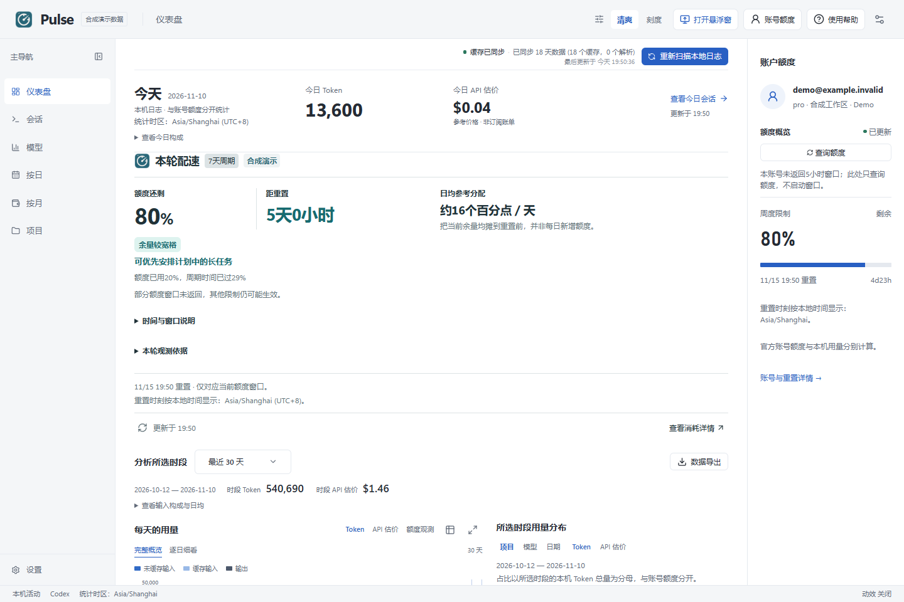
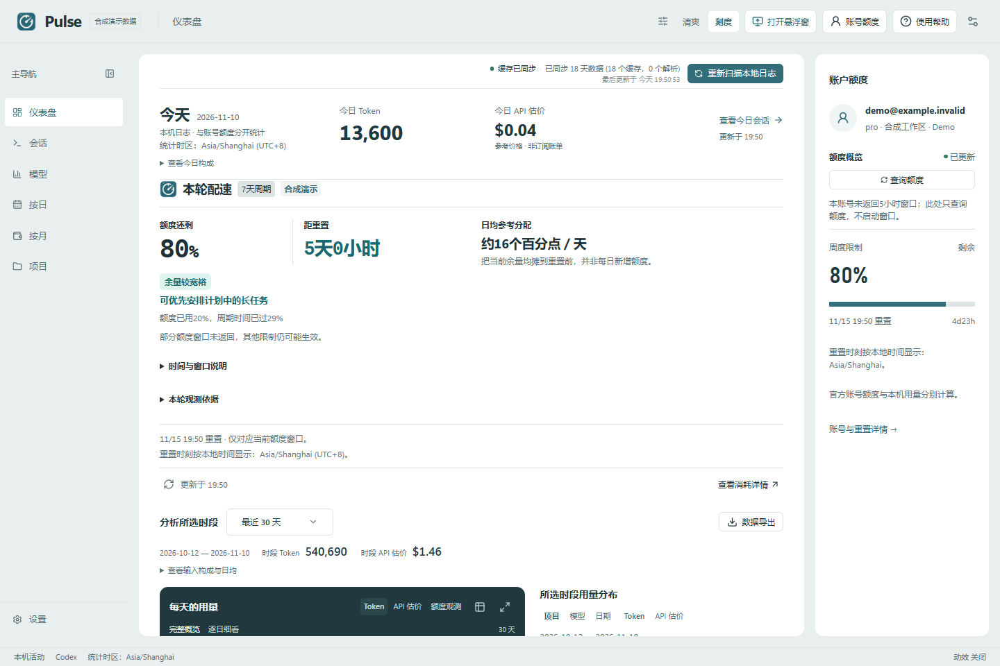
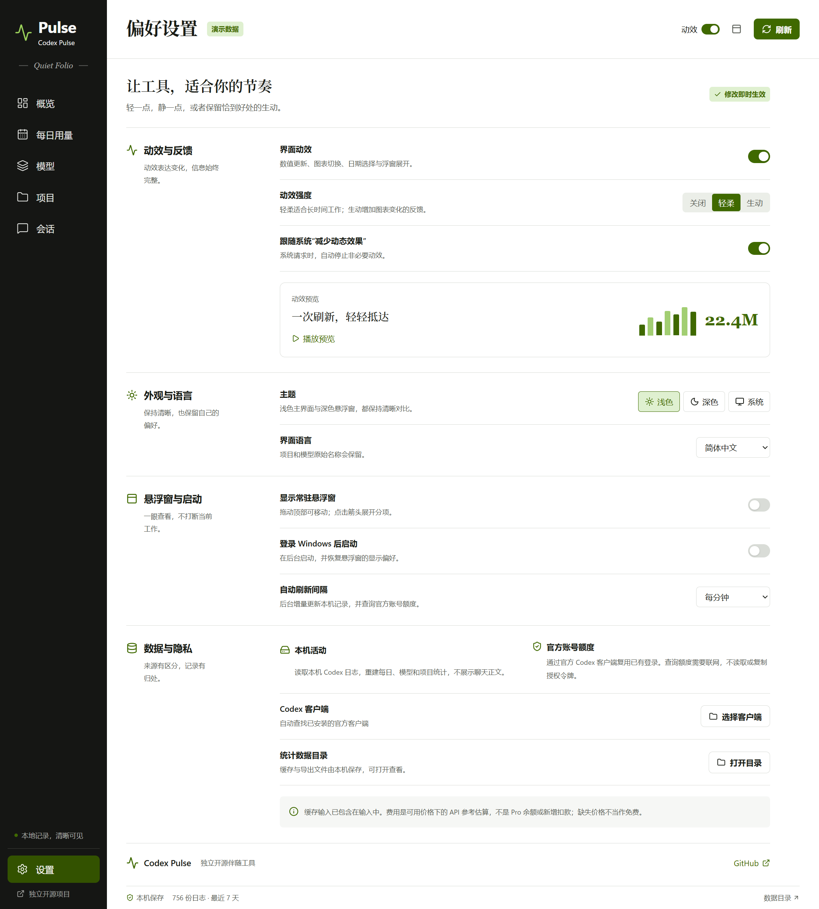
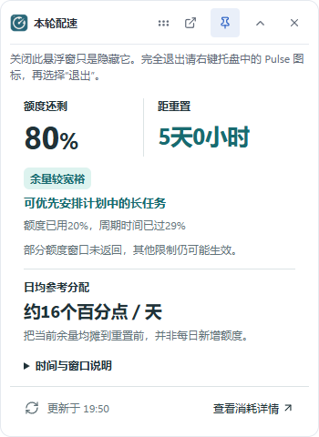

# Codex Pulse — Codex Usage Monitor for Windows

Track local Codex tokens, check your ChatGPT/Codex account quota, and keep remaining capacity in an always-on-top desktop widget. Codex Pulse is a Windows x64 usage monitor and token tracker with two interchangeable themes: **Clear** and **Meter**.

**[简体中文](README.md)** · **[Download v0.2.0](https://github.com/zhulongqihan/codex-pulse/releases/tag/v0.2.0)** · [Live demo](https://zhulongqihan.github.io/codex-pulse/) · [Screenshot gallery](https://zhulongqihan.github.io/codex-pulse/gallery.html) · [All releases](https://github.com/zhulongqihan/codex-pulse/releases) · [Report an issue](https://github.com/zhulongqihan/codex-pulse/issues)

> An independent, unofficial project. Codex Pulse is not affiliated with or endorsed by OpenAI. Screenshots and the browser demo use synthetic data; the demo cannot read your local logs or account.

## What you get in v0.2.0

- **Two themes, one workspace.** Clear keeps the presentation light and spacious; Meter emphasizes chart contrast and numerical hierarchy. Switching themes preserves your page, dates, filters, search, sorting, and selection.
- **Six usage views.** Dashboard, Sessions, Models, Daily, Monthly, and Projects, with a separate Settings page. Monthly groups activity within the selected date range by month.
- **Local token history.** Inspect input, cached input, output, and total tokens reconstructed from retained Codex session logs, with model, project, and session breakdowns.
- **Official account quota.** Reuse your existing Codex sign-in through the official local app-server to read the usage windows, remaining percentages, and reset times it returns.
- **A floating desktop widget.** Keep capacity and today's activity beside your work; open the dashboard when you need more detail.
- **Independent appearance controls.** Choose Clear or Meter, Light / Dark / System, and Off / Gentle / Full motion separately. System reduced-motion preferences are respected when enabled.
- **Complete date presets and custom ranges.** Choose 1, 2, 7, 14, 30, 60, 90, 180, or 365 days, all retained history, or a custom range that includes both its start and end date.
- **CSV and Markdown exports.** Export daily statistics for the current date range. The desktop save dialog starts in the app data directory's `exports` subfolder; you can choose another destination.
- **Local caches.** Keep app data on your chosen drive. Codex Pulse adds no analytics or telemetry.

## Clear or Meter

Both themes show the same data. Choose the presentation that suits your work in **Settings**.

| Clear | Meter |
|---|---|
|  |  |

| Settings | Floating widget |
|---|---|
|  |  |

## Start on Windows

1. Download [CodexPulse-0.2.0-windows-x64.zip](https://github.com/zhulongqihan/codex-pulse/releases/download/v0.2.0/CodexPulse-0.2.0-windows-x64.zip) and its `.sha256` file from the [v0.2.0 release](https://github.com/zhulongqihan/codex-pulse/releases/tag/v0.2.0).
2. Extract the entire ZIP to a writable directory, such as `F:\Apps\CodexPulse`. Keep all accompanying files together, then run **CodexPulse.exe**. The portable release does not require Node.js or npm.
3. For account quota, keep a compatible official Codex desktop or CLI installation signed in with **ChatGPT**. No separate API key or password entry in Pulse is needed. If automatic discovery fails, select the Codex executable in Settings.
4. Open Settings to choose your theme, color mode, motion, language, refresh interval, and widget visibility.

The app reads retained session files from your existing Codex home, normally `%USERPROFILE%\.codex`; an existing `CODEX_HOME` environment variable takes precedence. Local statistics can work even when account quota is unavailable. Closing the dashboard hides it; use **Quit** in the system tray menu to exit.

## Understand the numbers

| Number | Source | What it means |
|---|---|---|
| Daily, monthly, model, project, and session tokens | Retained local Codex logs | Activity recoverable on this computer, grouped in its local time zone |
| Remaining quota and reset times | Official Codex app-server | The usage windows actually returned for the signed-in account |
| Estimated cost, when available | Compatible local reference-price cache | An API token-price estimate, **not a ChatGPT Pro bill, credit balance, or additional charge** |

Cached input is already included in input tokens; it is not added to the total a second time. Account quota may include other devices, so local token totals cannot be converted directly into a remaining percentage.

Unknown quota is shown as unavailable, not as 0%. If an account refresh fails, the app identifies any retained result as the last successful data; existing local history remains available. Missing prices are not treated as free usage. A fresh installation may have no reference prices, and reference estimates do not cover every speed tier or tool charge.

## Data location and privacy

- **Portable release:** Pulse stores its preferences, statistics cache, browser cache, temporary files, and app logs in `data` beside the executable. Use any writable drive, including F:.
- **Source checkout:** app state defaults to `.local/data`. Installation caches and temporary files also use `.local` with the setup below. `.local` and `data` are excluded from Git.
- **Custom app data:** set `PULSE_DATA_DIR` to an absolute writable directory before starting Pulse. This changes Pulse's storage; Codex keeps its own logs and authentication in its existing locations.

The default desktop export location is `data/exports` in a portable installation, or the `exports` subfolder of your custom app data directory. Exports contain daily usage within the currently selected inclusive date range.

Original Codex session logs are read-only. Pulse's usage snapshots contain statistics and session metadata, not conversation text or authentication material. When present, a compatible local Codex Usage Desktop aggregate cache can accelerate the first view, and its reference-price cache can supply cost estimates; that application is optional.

Pulse does not ask you to copy `auth.json` or enter account credentials. The official Codex client manages authentication and any token refresh. Account refreshes contact OpenAI through that client; local usage statistics are not uploaded by Pulse. Share only synthetic or carefully redacted diagnostics in public issues. See [SECURITY.md](SECURITY.md) for private reporting.

## Current scope

v0.2.0 brings the two themes into the desktop app and adds the six-view navigation. It provides usage analysis and session metadata; **full conversation and tool-call replay is not included**. It does not claim feature parity with other Codex usage applications.

Local history depends on the files retained on this computer. Deleted logs, every cloud task, other-device history, all older log formats, and automatic WSL discovery are not covered. Account fields depend on what the installed Codex client and account service expose.

The current release does not include Credits or reset-credit details, reset forecasts, a complete model-price catalog, XLSX export, or in-app automatic updates. The session view shows usage and metadata; full messages, tool activity, and agent-tree replay are not available.

## Run from source

Requires **Node.js 24.10 or newer** and npm. Clone into any writable directory; F: or another drive works:

```sh
git clone https://github.com/zhulongqihan/codex-pulse.git
cd codex-pulse
npm --cache .local/cache/npm ci
npm run dev
```

To explore with synthetic data instead of your account and logs:

```sh
npm run dev -- --demo
```

Test and run the production build:

```sh
npm test
npm run build
npm start
```

Build the Windows x64 portable ZIP on Windows x64:

```sh
npm run package
```

The archive and SHA256 file are written to `release/`. Packaging excludes private app data and development caches.

<details>
<summary>Keep installation caches and temporary files on the checkout drive</summary>

The Electron postinstall wrapper defaults to the checkout's `.local` directory. npm downloads dependencies before that wrapper runs, so the commands above also set npm's cache explicitly. To keep the first install's temporary files there too, use these process-only PowerShell settings **before installing**:

```powershell
$env:npm_config_cache = "$PWD\.local\cache\npm"
$env:ELECTRON_CACHE = "$PWD\.local\cache\electron"
$env:electron_config_cache = $env:ELECTRON_CACHE
$env:TEMP = "$PWD\.local\tmp"
$env:TMP = $env:TEMP
New-Item -ItemType Directory -Force $env:TEMP | Out-Null
npm ci
```

Keep credentials, real conversation exports, and private diagnostics out of the repository.

</details>

## Contribute

Bug reports and focused pull requests are welcome. Read [CONTRIBUTING.md](CONTRIBUTING.md), explain the behavior you expect, and use synthetic data in screenshots and test fixtures. Run `npm test` and `npm run build` before submitting. A passing CI build does not guarantee complete historical accounting or replace checking the Windows application.

## Inspiration and license

The combination of a small usage companion and a detailed local dashboard was inspired by [ChatGPT-Usage](https://github.com/asetho/ChatGPT-Usage) and [Codex Usage Desktop](https://github.com/itvincent-git/codex-usage-desktop). Codex Pulse has its own implementation and visual identity. See [THIRD_PARTY_NOTICES.md](THIRD_PARTY_NOTICES.md).

Released under the [MIT License](LICENSE).
