# Codex Pulse — A Windows Quota-Pacing Companion

A quiet quota-pacing companion for Codex on Windows: view remaining quota and reset time together, compare consumption with the window's time progress, and plan upcoming tasks. Includes **Clear**, **Meter** and **Paper**, a full usage workspace, and session replay.

**[简体中文](README.md)** · **[Download for Windows](https://github.com/zhulongqihan/codex-pulse/releases/latest)** · [Product and interactive preview](https://zhulongqihan.github.io/codex-pulse/) · [Full workspace demo](https://zhulongqihan.github.io/codex-pulse/?demo=1) · [Screenshots](https://zhulongqihan.github.io/codex-pulse/gallery.html) · [Issues](https://github.com/zhulongqihan/codex-pulse/issues)

> Independent open-source software, not affiliated with OpenAI. Public screenshots and browser demonstrations use synthetic data only.

**Before downloading:** the app requires Windows 10/11 x64 and WebView2. The corner-following indicator supports the Microsoft Store edition of Codex only. Subscription quota requires an existing Codex ChatGPT sign-in; API-key mode can use local analysis. The desktop app reads the existing sign-in locally to query official account services, reads local logs without changing them, and does not upload conversations. The current EXE has no Windows Authenticode publisher signature; Pulse's update-manifest signature is a separate mechanism. [Downloads, data access and signatures](docs/TRUST.md#english).

## Features

- **Shared quota pacing:** the corner card, desktop widget and workspace share remaining quota, personal reset time, plain-language advice and daily/hourly reference allocations. Basic readings do not depend on a depletion forecast, and accounts returning only a weekly window remain useful.
- **Daily official quota history:** retain weekly and short-window observed consumption across resets, with daily coverage, gaps, cycle details and separate exports in Usage analysis.
- **Smooth client shortcut:** a shared icon and compact status without a brand word. The input-free card follows verified Microsoft Store Codex windows through Windows location events, hiding when another app is active, Codex is minimized or space is insufficient.
- **Pacing indicators** include a surplus hint near reset and a conditional remaining-at-reset range when enough observations are available. Open the information icon beside a reading to see how reference allocations are calculated.
- **Visible reset notices:** background notices show their source, expected window and unconfirmed state, with read state shared across windows. Expand explanations for expired, stale, unavailable or no-current-notice states and actual check times; a missing response is not inferred as withdrawal. Third-party global news stays separate from personal window expiry and is not presented as a personal reset confirmation.
- **A focused daily dashboard:** account quota and reset time appear separately from today's local activity. Today's local tokens lead, with the API cost estimate alongside them. Open pacing details and token breakdowns as needed.
- **Separate Usage analysis:** open selected-period totals, complete trends and project/model distributions, select a date for detail, and export the same range as XLSX or Markdown.
- **Seven work views:** dashboard, usage analysis and sessions are the main destinations. Models, daily, monthly and projects provide detailed views. Settings and optional diagnostics are also available. Clear and Meter have a collapsible, resizable sidebar, while Paper uses horizontal page tabs. Return from settings to your previous view.
- **Complete date ranges:** nine presets, all retained history and custom inclusive ranges. Daily averages use calendar days. The monthly view independently queries the current month to date and the previous 11 calendar months, distinguishing missing retention, partial retention and zero activity.
- **Tokens and reference costs:** input, cached input, output, cache hit rate, model unit prices and a searchable price catalog. Charts provide date selection, legends, units, a data table and fullscreen viewing. Compare models, dates and projects identified by their complete paths.
- **Main-list session search:** search loaded sessions by title, ID, model or project while retaining matching agent groups. Combine with project filters and clear the query to restore the original list, without rescanning logs. Project-detail and replay searches remain available.
- **Complete threads and read-only replay:** distinguish daily usage from a full thread. Inspect parent/child agents, messages, recorded reasoning summaries, tool results, patches, images, questions, searches and waits. Long messages open as previews with full text available on request; copying and search still use the complete content. Navigate turns, inspect raw JSONL and locate source files.
- **Account and resets on demand:** the existing account entry shows identity, workspace, subscription, quota windows, Credits, reset credits and reset details without repeating them across the dashboard. Read-only refresh is separate from confirmed window activation. Reset announcements, history, calendar, forecasts and feeds expose source and freshness.
- **Optional per-session Credits:** off by default; query only the real thread IDs currently being viewed, without sending conversation bodies. Preserve exact decimals, negative adjustments, cached values, cooldowns and unavailable states.
- **Local sources and maintenance:** incremental scanning, compressed archives, one selected native/WSL environment, targeted session/project rescans, diagnostics and cache rebuilding.
- **Desktop companions:** a configurable tray information panel and an independent draggable, pinnable, expandable quota-pacing widget. Launch at sign-in and automatic refresh are supported.
- **Codex desktop entry:** a local MCP plugin shows quota, today's summary and sourced notices in a desktop client with MCP Apps support. Open the dashboard, widget or consumption details. The six-language panel follows Pulse preferences by default, with optional panel-only Clear, Meter or Paper selection; see the [installation guide](docs/CODEX_INTEGRATION.en.md).
- **Three styles and six languages:** choose Clear, Meter or Paper under **Settings → Appearance**. Light/dark/system, density and motion are independent preferences. Switching styles preserves your working state. The floating widget follows the workspace style by default and can use a different style under **Settings → Desktop & Codex**. Supports Simplified Chinese, Traditional Chinese, English, Japanese, Korean and German.
- **Exports and updates:** XLSX/Markdown contain range summary, daily, model and project statistics. Pulse updates verify the release signature, product, platform and package digest, preserving data and restoring the previous executable if startup fails.
- **Help and feedback:** find usage guidance, experience discussions and bug reporting in settings. Preview a minimal summary of visible environment and selected options before copying it; account data, logs and conversations are not uploaded automatically.

0.14.4 limits the first information hint in the title-bar pacing panel to the reset time, quota used alongside cycle progress, and the last notice check. [Release notes](docs/releases/v0.14.4.md#english).

Paper companion views with synthetic data: [pacing details](docs/screenshots/paper-0.14.3-pace-panel.png) · [system tray](docs/screenshots/paper-0.13.2-tray.png) · [Codex panel styling](docs/screenshots/paper-0.14.3-mcp.png).

## Work context and interactive pace preview

| Clear | Meter |
|---|---|
| 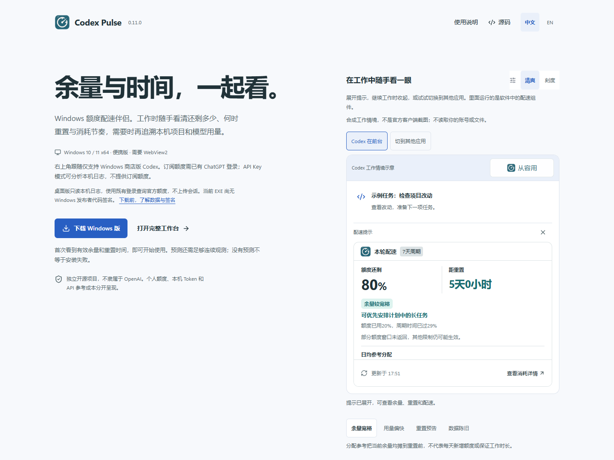 | 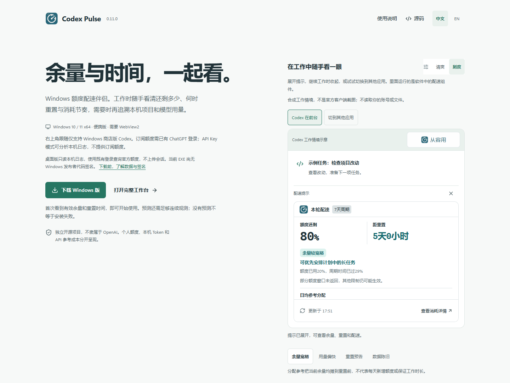 |

Try the [roomy quota](https://zhulongqihan.github.io/codex-pulse/?demo=1&coachScenario=roomy#pulse-pace), [high pace](https://zhulongqihan.github.io/codex-pulse/?demo=1&coachScenario=fast#pulse-pace), [reset notice](https://zhulongqihan.github.io/codex-pulse/?demo=1&coachScenario=notice#pulse-pace), and [stale data](https://zhulongqihan.github.io/codex-pulse/?demo=1&coachScenario=stale#pulse-pace) states. These run the implemented interface components with synthetic readings and notices only.

## Clear, Meter and Paper workspaces

| Clear | Meter | Paper |
|---|---| --- |
| 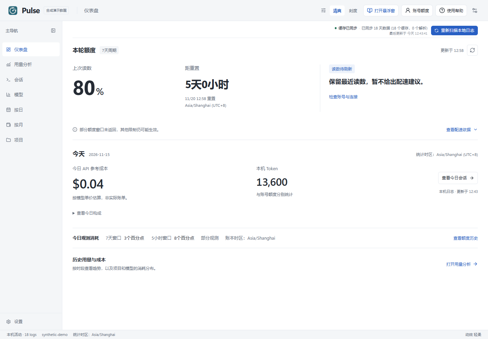 | 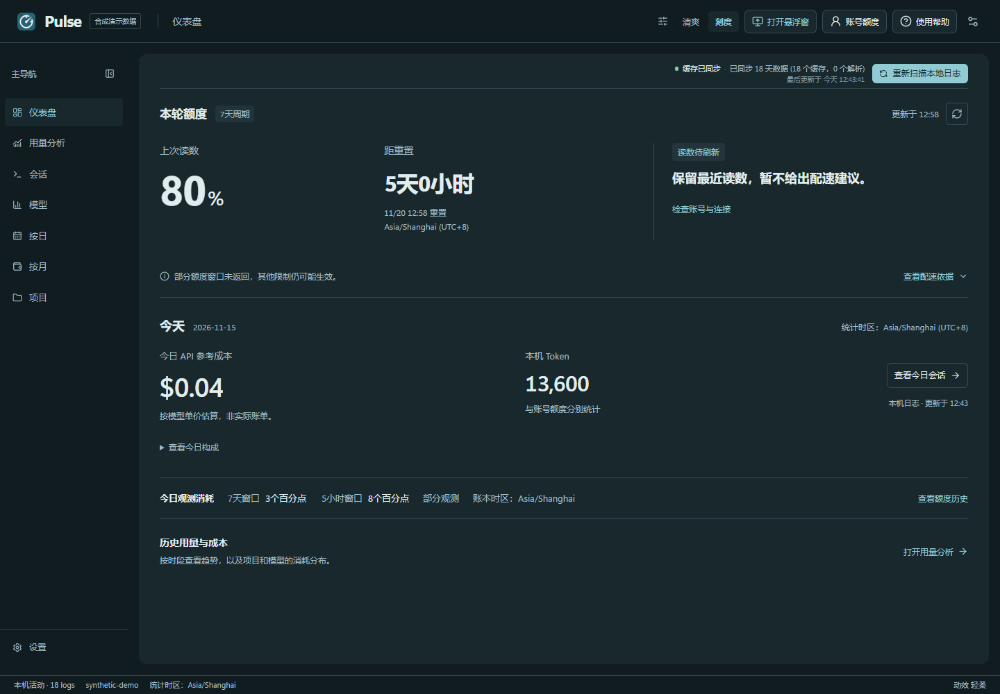 |  |

All three styles share the same capabilities. The dashboard shows remaining account quota, reset time and today's local tokens. Usage analysis offers complete-range trends, distributions and exports. Clear uses lightweight comparisons and continuous tables. Meter emphasizes one dark trend field, and Paper uses a bound-journal layout with page tabs and textured paper. Daily detail, a data table, fullscreen viewing and keyboard controls remain available.

### Separate Usage analysis

Open historical trends and distributions from **Usage analysis**. Today's dashboard remains independent; the range selector, chart and exports use the same period.

| Clear | Meter | Paper |
|---|---| --- |
| 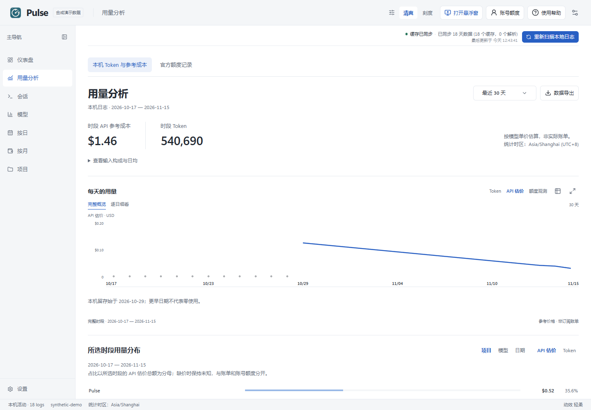 | 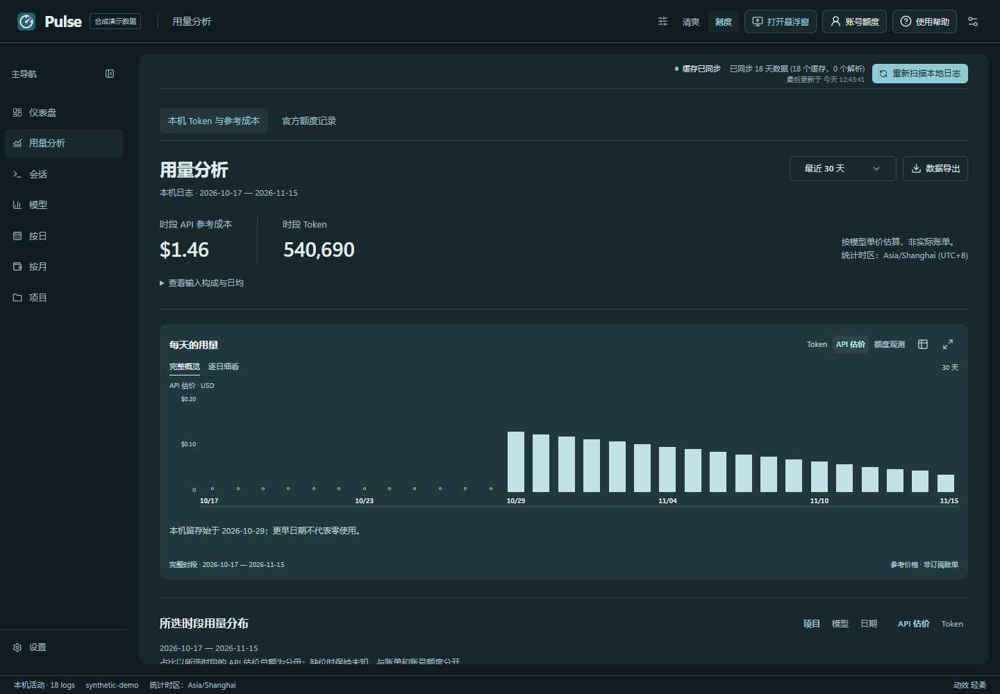 | 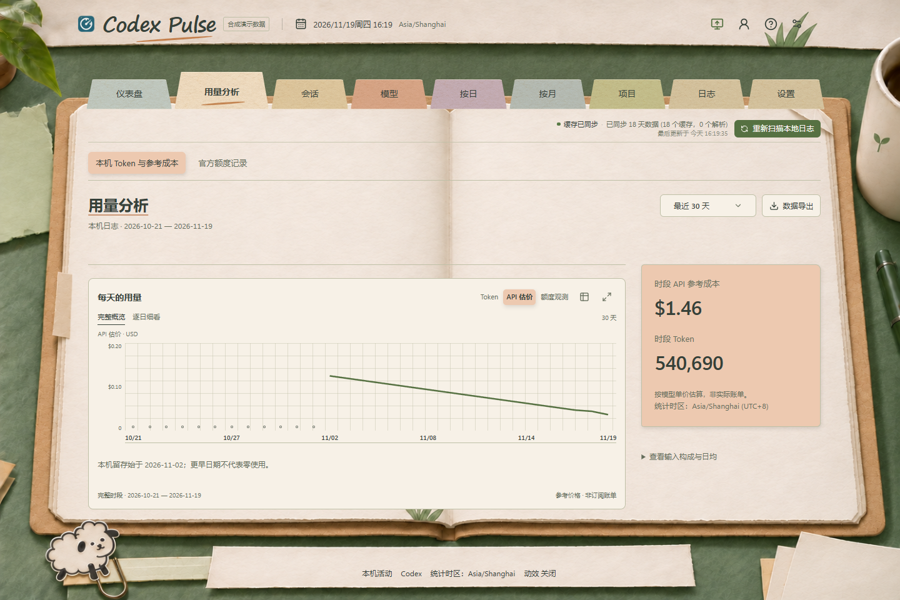 |

## Daily official quota history

The dashboard shows today's observed consumption. Open **Usage analysis → Official quota history** to choose a date range and quota window, inspect daily charts and cycle details, or export a separate XLSX or Markdown file. The total shows how many days had enough readings to calculate consumption for that window. To view earlier history under a different account or source, switch back to that account in Codex or restore the source under **Settings → Data source**. One query covers up to 366 days. Use a custom range to view earlier dates.

| Clear | Meter | Paper |
|---|---| --- |
| 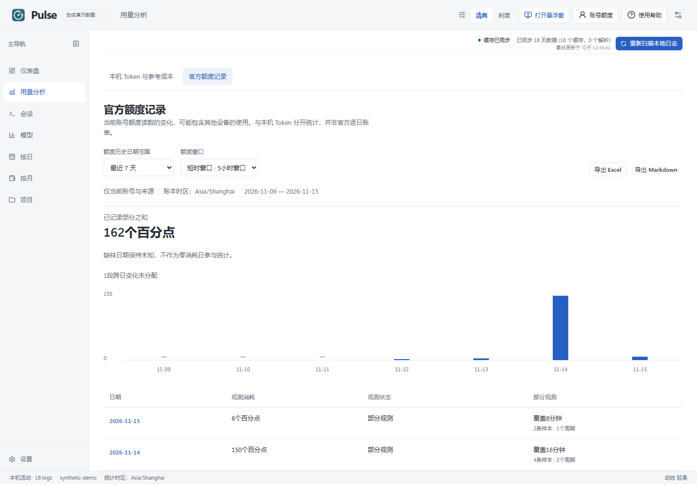 | 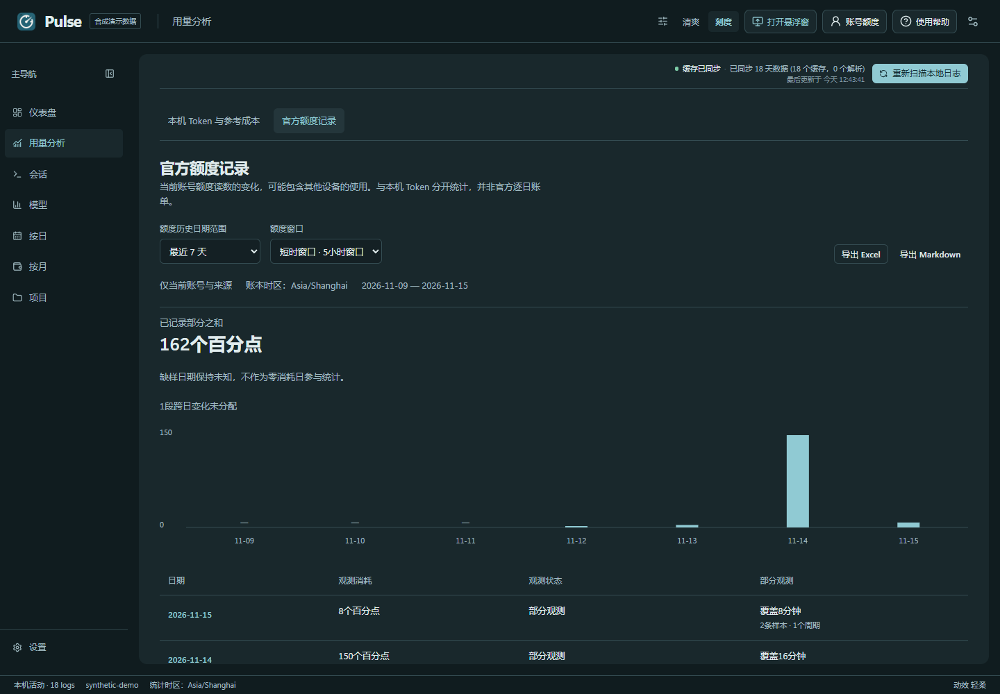 | 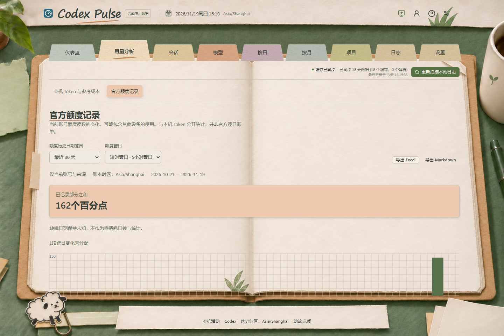 |

Recording is enabled by default and can be changed under **Settings → Data source**. While Pulse is running, it reads the selected account approximately every 60 seconds, with backoff for failures and rate limits. Hiding the main window, widget or corner indicator does not stop recording. Quitting or system sleep stops sampling; no system service or model request is added.

Values are **percentage points**: remaining quota moving from 80% to 72% records 8 points. Weekly and short windows have different denominators and stay separate. Several cycles in one day can exceed 100 points. Account readings can include activity on other devices.

Unknown days, a single baseline, unchanged readings and gaps remain distinct. Changes spanning midnight stay unallocated instead of being assigned or spread across days; missing samples are never zero-filled. A comparable same-day gap retains its endpoint change without claiming continuous coverage. The ledger timezone is fixed on first use and shown explicitly; later system or local-log timezone changes do not rewrite historical dates.

Only verifiable older partial observations with matching identity, window and timezone can be imported. Unrecorded history cannot be reconstructed. This is observed account data, not an official daily bill, and it is not added to local tokens, API reference costs or quota snapshots found in logs.

## Run on Windows

1. Download `CodexPulse-<version>-windows-x64.zip` and its `.sha256` file from the [latest release](https://github.com/zhulongqihan/codex-pulse/releases/latest).
2. Extract the complete archive into a writable folder, such as `F:\Apps\CodexPulse`. Run **Start-Codex-Pulse.cmd** or **CodexPulse.exe**.
3. Requires Windows 10/11 x64 and [Microsoft Edge WebView2 Evergreen Runtime](https://developer.microsoft.com/microsoft-edge/webview2/). The portable archive does not bundle that system runtime. Node.js and Rust are not required.
4. Confirm your Codex Home in settings, then choose appearance, local log scan interval and widget preferences. Account queries require an existing ChatGPT sign-in; API key mode does not expose subscription quotas.

On first open, look for **Account quota** and **Today's local usage** on the dashboard. Each updates as its data arrives. A weekly quota window provides usable remaining quota and reset information. If quota is missing, check sign-in and connection in the account panel. Local log analysis also works on its own. Open **Getting started** from the toolbar for reading guidance, data source settings and shortcut creation.

To add desktop and Start menu entries, use the app's shortcut action or run **Create-Codex-Pulse-Shortcuts.cmd** from the portable package. Recreate the shortcuts after moving the application directory.

Enable the **Codex corner pace indicator** in settings, keep Pulse running, and switch to the Microsoft Store edition of Codex for Windows. This is an independent Windows companion surface that follows the client; it does not modify Codex installation files. Click the status to expand; press Esc or click outside to dismiss. See the [full guide](docs/CODEX_INTEGRATION.en.md).

For automatic following after a restart, enable **Settings → General → Start Pulse at sign-in**. Pulse then runs in the tray after Windows sign-in. Opening Codex alone does not launch a Pulse instance you have quit. Settings distinguish checking, enabled, disabled and unconfirmed startup states.

The existing sidebar entry remains available: choose **Settings → Desktop & Codex → Codex desktop shortcut → Add to Codex**, then install and pin it. The MCP panel only reads local snapshots, with no independent sign-in or quota request. Its bottom composer belongs to the Codex host and cannot be reliably hidden by Pulse. The new corner card has no input box.

Starting with 0.7.1, normal startup prepares or repairs local plugin files from embedded templates, and portable upgrades no longer overwrite the prepared plugin directory. An existing Codex window retaining a failed old plugin cache may need the plugin added again before retrying. After moving the application directory, check entry bindings in **Settings → Desktop & Codex** and repair them as needed. A cached plugin in the Codex host may still require reinstallation on its plugin page.

Opening the app again restores the window for the same data folder. Closing the main window hides it to the tray. Closing the desktop widget only hides that widget; show it again in settings. Closing the expanded corner card only collapses that card. Choose **Quit** in the tray menu to exit completely. The widget pin names the current action: **Pin on top** or **Unpin from top**. Check for updates in settings, or exit the app and replace program files with a newer release while keeping `data`.

Retry a failed reset service directly from its error message without rescanning local logs. After relocating the complete portable folder, use **Settings → Desktop & Codex** to check desktop, Start menu, sign-in startup and local plugin bindings, inspect the previous target and its impact, then choose repairs individually. Unconfigured entries stay unconfigured; checks do not change system settings.

The Models page explains missing historical quota samples rather than presenting unknown values as zero. The expanded widget shrinks when no valid quota reading is available. Expand usage help for explanations of quota sources, readings and recovery actions.

## Understanding the data

| Measurement | Source and limits |
|---|---|
| Local tokens and conversations | Retained Codex logs, grouped in the statistical time zone shown in the interface; deleted records or unsynced history from other devices cannot be reconstructed |
| Daily official quota history | Comparable changes in the current account readings, grouped in the fixed ledger timezone; unknown days stay unknown, cross-day changes stay separate, and history survives resets |
| Account capacity and Credits | Fields actually returned by the official account service; these may include other devices; missing fields remain unknown |
| Quota pacing and conditional forecasts | Pacing compares the remaining quota and time in the same actual window. Forecasts additionally require at least 15 minutes and significant observed consumption; quantization and recent variation widen the range, and local tokens are never converted to quota |
| API reference costs | Model reference prices, **not subscription bills, Credits charges or extra fees**; missing prices remain unknown, while genuinely free models show zero |
| Historical quota estimates | Correlated observations from 5-hour and weekly windows, with bounds and sample counts; other windows are not estimated, and current quotas are not spread over historical usage |
| Reset forecasts and feeds | Third-party information with source, timestamp and stale states; a forecast does not guarantee a reset |

Cached input is already part of input and is never added twice. One thread can span multiple dates, models and projects; a daily row is not presented as its complete lifecycle.

The pace sampler makes a read-only query about every 60 seconds by default, with cooldowns for errors and rate limits. It sends no model requests and does not enable per-session Credits. Account changes, window resets, decreasing consumption or observation gaps over 10 minutes start new segments; readings older than about 6 minutes stop the estimate. Project/model shares describe today's local tokens, not the same share of subscription quota.

Slower weekly changes accumulate a longer continuous observation span. An unchanged percentage does not mean no usage. Basic pacing still shows known quota and reset time without a forecast; local daily tokens remain in the workspace. Some accounts return only a weekly window; an omitted short window does not mean zero remaining quota.

Time progress is derived from the official window duration and reset time, independently of when Pulse was installed. Official quota history uses the ledger time zone. Reset timestamps use the current local time zone. Consumption shares describe local tokens within the selected period, separately from account quota shares.

**Activate window** sends a minimal model request through Codex CLI after explicit confirmation and may consume quota. Ordinary refresh never activates a window. Completion of the CLI request is checked separately from confirmation that the quota window became active.

## Storage and privacy

- The portable app keeps its database, preferences, logs, temporary files and WebView profile in the adjacent **data** folder. Move the entire folder to relocate it.
- Development defaults to `.local/data`. `PULSE_DATA_DIR` selects an absolute writable app-data directory; `PULSE_CODEX_HOME` selects the read-only log source.
- Original session files are read-only. Replay reads messages and tool records; the app's indexes and caches are private material and should not be published without review.
- The Rust process reads the existing sign-in to query official account services. Credentials are not exposed to the renderer, exports or public logs. The official Codex client remains responsible for sign-in and token renewal.
- Daily quota history uses separate `quota-history.db` and `quota-recording-preferences.json` files. Rebuilding the log cache does not delete this ledger, and disabling recording retains history. Quit Pulse before moving or backing up the complete `data` folder.
- Pace observations use the same data folder and retain only a local identity hash; renderer and MCP snapshots expose neither the hash nor credentials.
- Pulse adds no telemetry and does not upload local conversations. Per-session Credits send only the viewed thread IDs. Pricing and reset information have separate external sources.
- Upgrading retains old data files and imports compatible appearance, language, refresh and widget preferences. The old executable-selection setting remains in its original configuration file.

Account, Credits and reset data can be unavailable because of sign-in, permissions, rate limits, API changes or connectivity. Local analysis remains usable; failures do not fabricate values. The browser demo cannot read real files, run model requests or install updates.

## Build from source

Requires Node.js `^24.15.0 || >=26.0.0`, pnpm 10.20, Rust 1.94.1, MSVC x64 Build Tools and WebView2.

```powershell
git clone https://github.com/zhulongqihan/codex-pulse.git
Set-Location codex-pulse
. ./scripts/build-env.ps1
pnpm install --frozen-lockfile
pnpm dev:app
```

The build environment places caches and target output on the checkout drive in the adjacent `.cache/codexpulse-parity` folder. It changes only the current process environment and uses the existing MSVC installation.

```powershell
pnpm typecheck
pnpm test
cargo test --locked --manifest-path src-tauri/Cargo.toml --lib
pnpm test:e2e:build
pnpm exec wdio run ./wdio.pulse.conf.ts
./scripts/package-portable.ps1
```

Archives and digests are written to `release/`. For a synthetic browser preview, run `pnpm dev` and open `http://127.0.0.1:5173/?demo=1`.

After Checks passes for an exact main commit, maintainers can manually build an [unsigned production candidate with source and hash metadata](docs/PRODUCTION_CANDIDATES.md). It is separate from a formal release and Windows publisher signing.

## Feedback and participation

Tell us what works well, what feels awkward, and what you would like to see next. You do not need to write code to help:

Open **Settings → Help & feedback** for usage guidance, experience discussions or the bug form. The optional feedback summary displays its complete content before you choose whether to copy and send it; it does not automatically include real accounts, quota, project paths, conversations or raw error logs. Posting on GitHub requires sign-in; the browser demo does not.

| Clear | Meter |
|---|---|
| 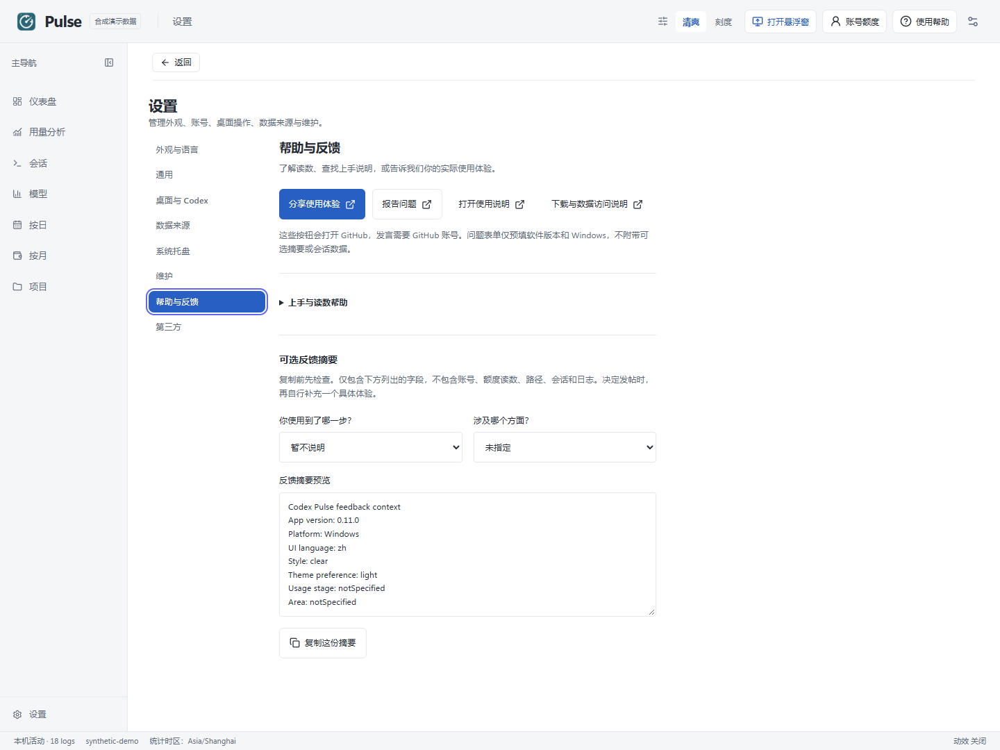 | 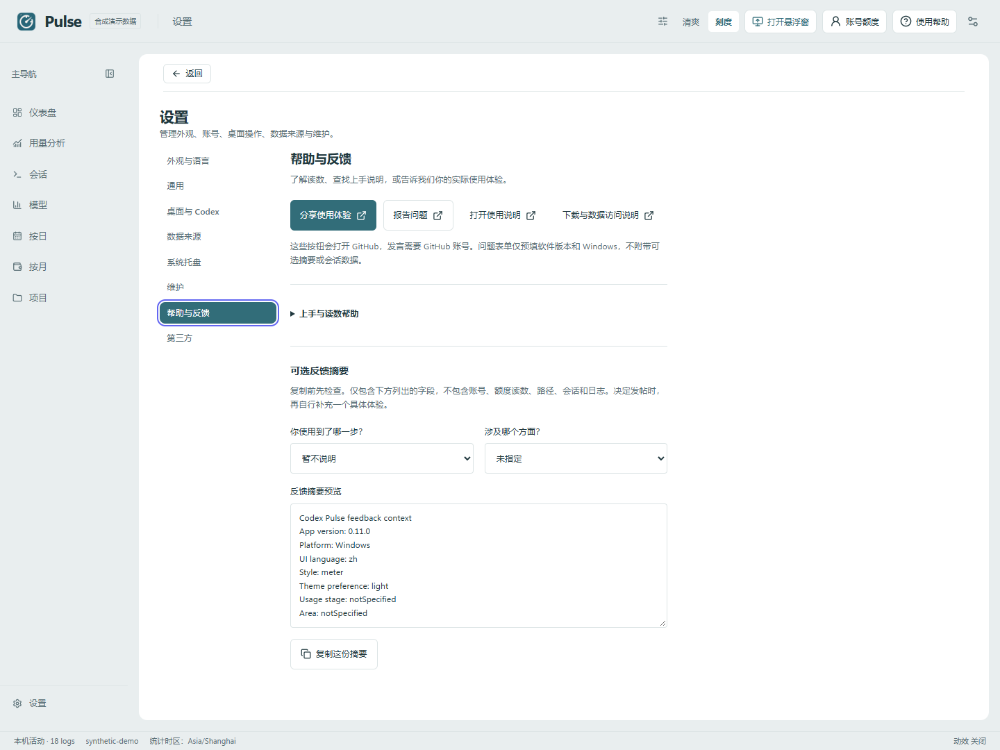 |

- [Report a bug](https://github.com/zhulongqihan/codex-pulse/issues/new?template=bug_report.yml) with the app version, reproduction steps, and expected/actual behavior.
- [Suggest a feature](https://github.com/zhulongqihan/codex-pulse/issues/new?template=feature_request.yml), or share experiences, ideas, and questions in [Discussions](https://github.com/zhulongqihan/codex-pulse/discussions).
- [Contribute](CONTRIBUTING.md) code, documentation, translations, or interface improvements. The [feedback guide](SUPPORT.md) explains which channel to use and what information helps.

Each application update goes through a user-workflow review, necessary corrections, and regression checks before release notes and packages are delivered through GitHub Releases. When feedback is addressed, the relevant issue or discussion will link to the fixing commit or published version so progress is easy to follow. Redact private information from screenshots; never upload raw conversations or authentication files.

## License and attribution

MIT licensed. The Rust engine, orchestration, replay components, translations and tests reuse [Codex Usage Desktop 5.6.0](https://github.com/itvincent-git/codex-usage-desktop) by Vincent and contributors, with its original license preserved. Pulse adds its own identity, Clear, Meter and Paper interfaces, portable storage, floating widget and update channel.

[Changelog](CHANGELOG.md) · [Versioning and compatibility](VERSIONING.md) · [Source notices](THIRD_PARTY_NOTICES.md) · [Dependency licenses](THIRD_PARTY_LICENSES.txt) · [Contributing](CONTRIBUTING.md) · [Privacy and security reporting](SECURITY.md)

[Privacy and network access](PRIVACY.md#english) · [Uninstallation and data retention](docs/UNINSTALL.md#english) · [Code signing policy](docs/CODE_SIGNING.md#english)
