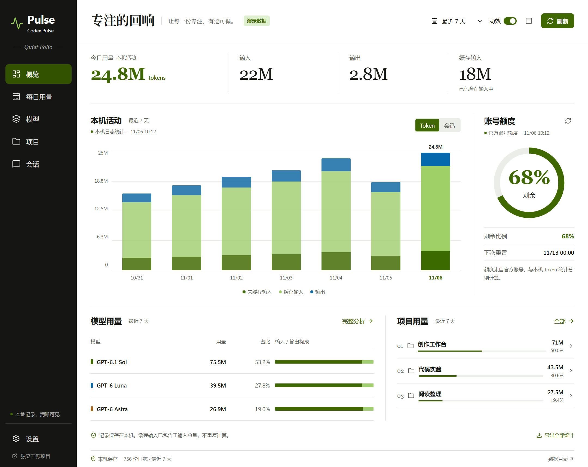
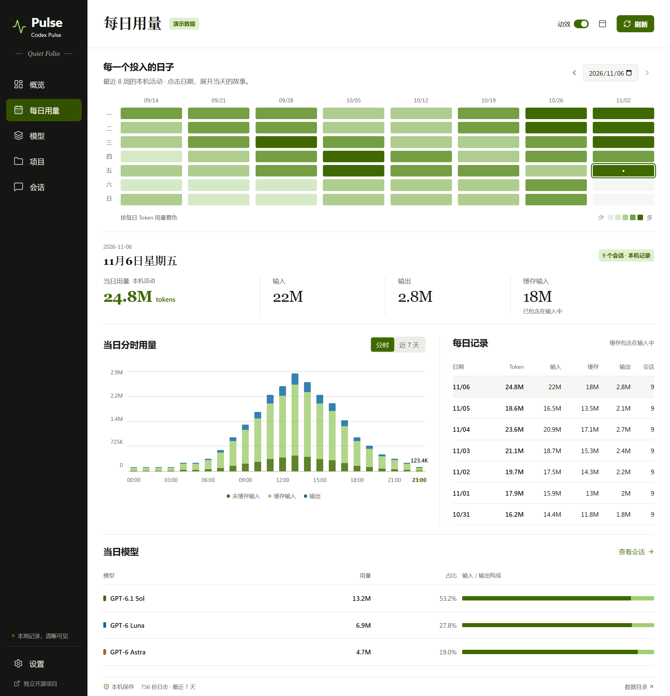
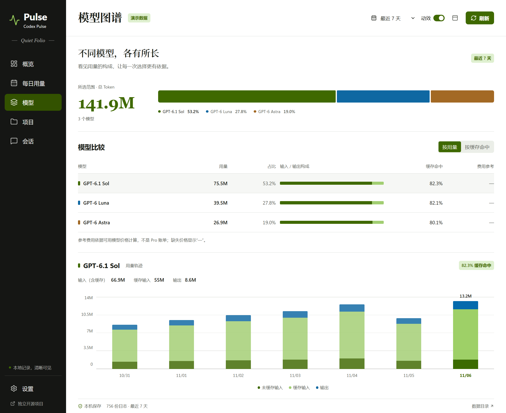
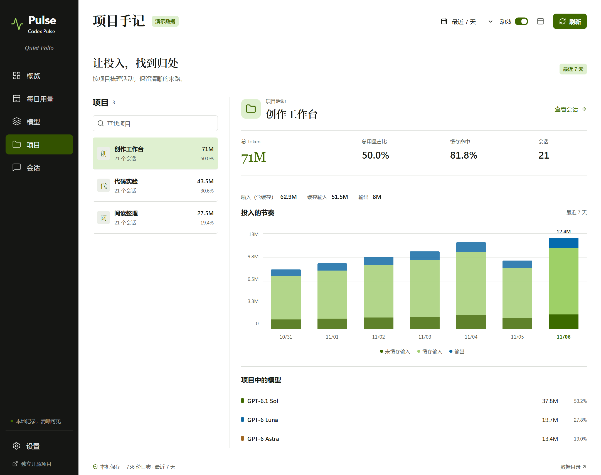
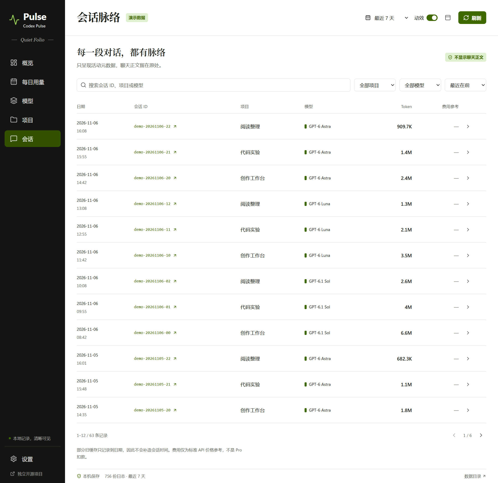
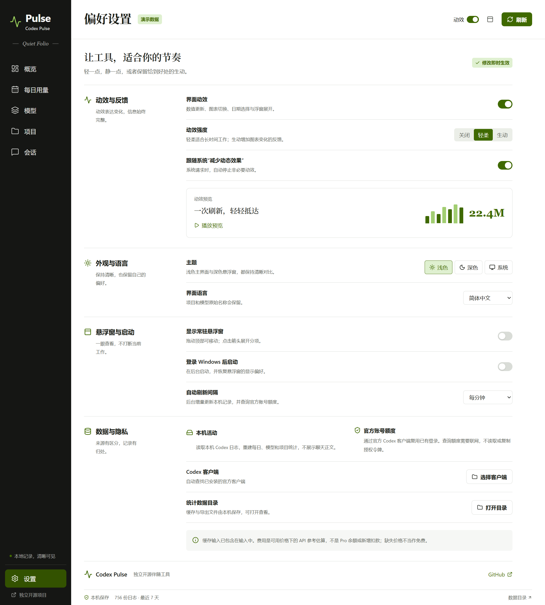

# Codex Pulse

A quiet desktop companion for understanding your Codex usage.

**[简体中文](README.zh-CN.md)** · [Download](https://github.com/zhulongqihan/codex-pulse/releases) · [Try the demo](https://zhulongqihan.github.io/codex-pulse/) · [Seven-view gallery](https://zhulongqihan.github.io/codex-pulse/gallery.html) · [Report an issue](https://github.com/zhulongqihan/codex-pulse/issues)

Keep remaining capacity in a small floating window. Open the full workspace when you want to understand a day, a model, or a project. Codex Pulse brings these two views together while keeping their data sources clear.


> Screenshots use demonstration data, not a real account. Codex Pulse is an independent project and is not affiliated with or endorsed by OpenAI.

## What it does

- **A glanceable widget.** Keep an optional always-on-top view beside your work, then open the dashboard for detail.
- **Daily history.** Inspect input, cached input, output, and total tokens reconstructed from retained local Codex logs.
- **Useful breakdowns.** Explore usage by model, project, and session without turning conversation text into a dashboard feed.
- **Account capacity.** Read the limits and reset information returned by your existing Codex sign-in through the official local app-server.
- **Motion you control.** Disable interface animation in Settings; system reduced-motion preferences are respected.
- **Local storage.** Aggregate caches and preferences stay on your computer. No analytics or telemetry is added by Codex Pulse.

## Start on Windows

1. Download a Windows portable ZIP from [Releases](https://github.com/zhulongqihan/codex-pulse/releases). Check its SHA256 against the release checksum file.
2. Extract the whole ZIP to a writable directory of your choice. Keep the accompanying files together.
3. Run the included application. Leave your existing Codex installation signed in with ChatGPT; no API key is needed for subscription-capacity information.

The main window shows the detailed view; the widget can be shown or hidden from the app. Open **Daily** to inspect a date, **Models** or **Projects** to find where usage went, and **Settings** to control motion and appearance. If one source is unavailable, existing data from the other source remains visible.

An unavailable account source does not turn retained local history into zero usage. Official limits that have not been returned are shown as unavailable rather than invented; today's local tokens are reconstructed independently from retained logs.

## Read the numbers correctly

| Number | Source | Meaning |
|---|---|---|
| Daily and session tokens | Local session logs | Activity retained on this computer; missing or deleted logs cannot be reconstructed |
| Remaining capacity and reset time | Codex account service | The limits currently reported for the signed-in account and workspace |
| Any cost estimate | Available model pricing | An API-price reference, **not a Pro bill, wallet balance, or additional charge** |

Cached input is already part of input tokens. It must not be added to the total a second time. Account-wide capacity can include activity from other devices, so local token totals cannot be converted directly into a remaining percentage.

## A closer look




<details>
<summary>Daily, model, project, session, and settings views</summary>

| Daily | Models |
|---|---|
|  |  |
| Projects | Sessions |
|  |  |



</details>

## Run from source

Use Node.js 24 and npm. Clone the repository into a writable directory:

```sh
git clone https://github.com/zhulongqihan/codex-pulse.git
cd codex-pulse
npm --cache .local/cache/npm install
npm run dev
```

For a production build:

```sh
npm test
npm run build
npm start
```

Create the distributable with `npm run package`. Use `npm --cache .local/cache/npm ci` for a clean install from the committed lockfile. Packaging is performed on Windows for the Windows release.

The Electron postinstall wrapper defaults its download and temporary directories to the checkout's `.local` folder. npm downloads dependencies before postinstall, so the commands above also explicitly place npm's cache on that drive. For equivalent process-only configuration, set these paths **before the first install** in PowerShell:

```powershell
$env:npm_config_cache = "$PWD\.local\cache\npm"
$env:ELECTRON_CACHE = "$PWD\.local\cache\electron"
$env:electron_config_cache = $env:ELECTRON_CACHE
$env:TEMP = "$PWD\.local\tmp"
$env:TMP = $env:TEMP
New-Item -ItemType Directory -Force $env:TEMP | Out-Null
npm ci
```

The `.local` directory is excluded from Git. Do not place private exports or account files in the source tree.

## Privacy and limitations

Codex Pulse reads usage events from Codex session files, including retained archived records where supported. Original `.codex` logs are read-only; only the app's own aggregate cache is written. It does not need your password or a copy of `auth.json`. Codex handles its own authentication lifecycle, including any refresh performed by its app-server.

Account refreshes contact OpenAI through the existing Codex client. Opening the repository or release page is an explicit external link. Local statistics do not imply that other-device history, every cloud task, or every historical log format is covered. Codex log formats and account-service capabilities can change.

See [SECURITY.md](SECURITY.md) before reporting an issue that could contain private information, and [CONTRIBUTING.md](CONTRIBUTING.md) for development guidelines. CI checks source tests and the build; a green build is not a claim of an independent security audit or perfect historical accounting.

## Inspiration and license

The combination of a small usage companion and a detailed local dashboard was inspired by [ChatGPT-Usage](https://github.com/asetho/ChatGPT-Usage) and [Codex Usage Desktop](https://github.com/itvincent-git/codex-usage-desktop). Codex Pulse has its own implementation and visual identity. See [THIRD_PARTY_NOTICES.md](THIRD_PARTY_NOTICES.md).

Released under the [MIT License](LICENSE).

Reference cost is optional and uses an available local pricing cache. A clean installation may show unconfigured pricing; this reference does not cover every speed tier or tool charge.
