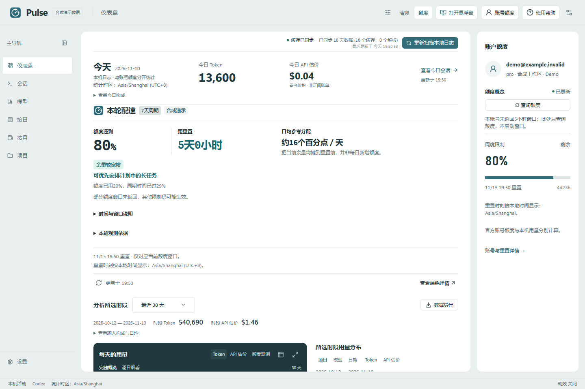

# Codex Pulse — 看见个人额度的消耗节奏

给 Windows 上的 Codex 一个随手可看的节奏提示：从连续官方额度观测估算触顶区间，提示是否可能早于重置；再按项目和模型查看本机 Token 来源。提供 **清爽 Clear** 与 **刻度 Meter**、完整用量工作台与会话回放。

**[English](README.en.md)** · **[下载 Windows 版](https://github.com/zhulongqihan/codex-pulse/releases/latest)** · [产品与交互演示](https://zhulongqihan.github.io/codex-pulse/) · [完整工作台演示](https://zhulongqihan.github.io/codex-pulse/?demo=1) · [截图](https://zhulongqihan.github.io/codex-pulse/gallery.html) · [反馈](https://github.com/zhulongqihan/codex-pulse/issues)

> 独立开源项目，不隶属于 OpenAI。公开截图与网页演示仅使用合成数据。

## 功能

- **Codex 右上角节奏提示**：统一软件图标加紧凑状态，不占一行品牌文字。点击展开无输入框卡片，查看触顶区间、与重置的先后关系和今日本机 Token 来源。跟随 Windows 商店版 Codex 客户端，切到其他窗口、最小化或空间不足时隐藏。
- **个人额度趋势**：至少 4 个有效观测、跨度至少 15 分钟，按同账号、工作区、来源与真实额度窗口分别采样。给出保守区间；未知、采样中、缓慢、无变化、陈旧和过期均保持独立状态。时间区间不是可工作时长或请求次数承诺。
- **先看今天与现在**：本机今日用量独立于历史筛选，账号剩余额度与重置时间保持可见。完整区间的趋势和主要消耗来源集中呈现，再按需展开逐日细节。
- **六个工作视图**：总览、会话、模型、按日、按月、项目；另有设置与可选诊断日志。导航可折叠、调宽，设置返回原页。
- **完整范围统计**：九种日期预设、全部留存和自定义闭区间；日均按自然日计算。按月独立展示当前月至今及前 11 个自然月，区分无留存、部分留存和零活动。
- **Token 与参考成本**：输入、缓存输入、输出、缓存命中、模型单价与价格目录。图表支持日期选择、图例、单位切换、数据表与全屏；可比较模型、日期和完整路径项目。
- **完整线程与只读回放**：区分每日统计和完整线程，查看父子代理、消息、日志中已有的推理摘要、工具结果、补丁、图片、问答、搜索和等待活动；支持回合导航、内容搜索、原始 JSONL、复制与定位文件。
- **账号与重置**：显示官方返回的账号、工作区、订阅、额度窗口、倒计时、Credits 和 reset credits；只读刷新与需要确认的窗口激活分开。重置公告、历史、日历、预测和 Feed 标明来源及时效。
- **可选逐会话 Credits**：默认关闭；开启后仅查询正在查看的真实线程 ID，不发送正文。保留精确小数、负数调整、缓存、冷却与不可用状态。
- **本地来源与维护**：增量扫描、压缩归档、原生／WSL 来源择一、定向会话／项目重扫、故障诊断与缓存重建。
- **桌面伴侣**：托盘信息板与独立可拖动、置顶、展开／收起的悬浮窗；两者指标配置独立。支持登录启动和自动刷新。
- **Codex 客户端入口**：通过本地 MCP 插件，在支持 MCP Apps 的桌面客户端中查看额度与今日汇总，并打开主窗／浮窗。提供清爽与刻度面板，使用中英界面；[安装说明](docs/CODEX_INTEGRATION.md)。
- **两版外观与六种语言**：清爽／刻度、浅色／深色／系统、密度与动效分别选择；切换保留正在查看的数据。支持简体中文、繁体中文、English、日本語、한국어、Deutsch。
- **导出与更新**：XLSX／Markdown 包含所选范围的汇总、日期、模型和项目。自有更新源验证签名、品牌、平台与包摘要，更新失败保留数据并恢复原程序。

## 节奏卡片交互预览

| 清爽 Clear | 刻度 Meter |
|---|---|
|  |  |

直接试用 [触顶区间](https://zhulongqihan.github.io/codex-pulse/?demo=1&paceScenario=forecast#pulse-pace)、[采样中](https://zhulongqihan.github.io/codex-pulse/?demo=1&paceScenario=sampling#pulse-pace)和[数据陈旧](https://zhulongqihan.github.io/codex-pulse/?demo=1&paceScenario=stale#pulse-pace)。这里运行已实现的界面组件，读数全部为合成示例。

## 两版工作台

| 清爽 Clear | 刻度 Meter |
|---|---|
|  |  |

两版共用业务能力。清爽使用轻量比较图与连续表格；刻度突出一块深色趋势区域。概览适配整个所选范围，逐日细看、数据表、全屏和键盘操作保持可达。

## Windows 启动

1. 在 [发布页](https://github.com/zhulongqihan/codex-pulse/releases/latest) 下载 `CodexPulse-<版本>-windows-x64.zip` 和对应 `.sha256` 文件。
2. 完整解压到可写目录，例如 `F:\Apps\CodexPulse`，双击 **Start-Codex-Pulse.cmd** 或 **CodexPulse.exe**。
3. 需要 Windows 10/11 x64 和 [Microsoft Edge WebView2 Evergreen Runtime](https://developer.microsoft.com/microsoft-edge/webview2/)。便携包不包含该系统运行时，不需要 Node.js 或 Rust。
4. 在设置中确认 Codex Home，选择外观、刷新间隔与悬浮窗。账号查询需要已有的 ChatGPT 登录；API Key 模式不提供订阅额度。

需要桌面与开始菜单入口时，可使用程序内的创建快捷方式操作，或运行便携包中的 **Create-Codex-Pulse-Shortcuts.cmd**。移动程序目录后，重新创建即可修复入口。

使用右上角提示时，在设置中开启 **Codex 右上角节奏提示**，保持 Pulse 运行，再切到 Windows 商店版 Codex 客户端。它是独立 Windows 伴随窗口，显示位置由程序跟随客户端计算，不修改 Codex 安装文件；点击状态条展开，按 Esc 或点击外部关闭卡片。[完整说明](docs/CODEX_INTEGRATION.md)。

原有侧栏入口仍可使用：在 **设置 → 常规 → Codex 客户端快捷入口** 点击 **添加到 Codex**，在插件页安装并固定。MCP 面板只读本地快照，不独立登录或请求额度；其底部输入框由 Codex 宿主管理，Pulse 无法可靠隐藏。新的右上角卡片没有输入框。

再次双击启动入口会找回同一数据目录的窗口。关闭主窗口会隐藏到托盘；使用托盘的 **退出** 完全结束程序。新版本可从设置检查更新，也可退出程序后解压新版覆盖程序文件并保留 `data`。

## 数据口径

| 数据 | 来源和边界 |
|---|---|
| 本机 Token 与会话 | 实际保留的 Codex 日志，按本机时区统计；无法恢复已删除记录或其他设备未同步的日志 |
| 账号额度、Credits | 官方账号服务实际返回的字段，可能包含其他设备消耗；缺字段显示未知 |
| 个人节奏与触顶区间 | 同账号、同真实窗口的连续官方额度观测，至少 15 分钟且有足够正消耗后估算；量化误差与近期变化扩宽区间，不将本机 Token 换算为额度 |
| API 参考成本 | 模型参考价格，**不是订阅账单、Credits 扣款或额外收费**；无价格显示未知，免费模型才显示零 |
| 历史额度估计 | 基于可关联的 5 小时／周窗口观测样本，保留上下界和样本量；其他窗口不可估，不把当前额度摊到历史 |
| 重置预测与 Feed | 第三方信息，显示来源、时间与陈旧状态；预测不保证实际发生 |

缓存输入已经包含在输入 Token 中，不能再次加到总量。一次线程可能跨日期、模型和项目；每日行不会冒充完整生命周期。

节奏采样默认约每 60 秒只读查询，错误与限流时冷却；不发起模型请求，不启用逐会话 Credits。换账号、窗口重置、负增量或超过 10 分钟的观测间隔会重新分段；超过约 6 分钟未更新时停止预测。项目／模型占比只代表本机今日 Token，不代表它们占用了同等比例的订阅额度。

“启动窗口”会在明确确认后通过 Codex CLI 发出最小模型请求，可能消耗额度；普通刷新不会激活窗口。CLI 请求结束后还需重新查询额度确认结果。

## 数据位置与隐私

- 便携版的数据库、偏好、日志、临时文件和 WebView 缓存都在程序旁的 **data** 文件夹。移动整个文件夹即可迁移。
- 开发运行默认使用 `.local/data`。`PULSE_DATA_DIR` 可指定绝对可写目录；`PULSE_CODEX_HOME` 可指定只读来源。
- 原始会话文件保持只读。回放会读取正文与工具记录，应用自己的索引和缓存也属于私人资料，不应直接公开。
- 账号查询在 Rust 进程中读取既有登录并访问官方服务；凭证不传给前端、不进入导出或公开日志。登录与令牌续期仍由官方 Codex 管理。
- 节奏观测缓存在同一数据目录，身份仅保留本地哈希；前端与 MCP 快照不包含身份哈希或凭证。
- Pulse 不添加遥测，不上传本机对话。逐会话 Credits 仅发送已查看线程的 ID；外部价格与重置服务各有独立来源。
- 从旧版升级时保留旧数据文件，并导入兼容的外观、语言、刷新与悬浮窗偏好；旧可执行文件选择项仍留在旧配置中。

账号、Credits、重置服务可能因登录、权限、限流、接口变更或网络不可用而缺少数据。本地分析仍可使用；失败不会伪造数值。浏览器演示不能读取真实文件、执行模型请求或安装更新。

## 从源码构建

需要 Node.js `^24.15.0 || >=26.0.0`、pnpm 10.20、Rust 1.94.1、MSVC x64 Build Tools 和 WebView2。

```powershell
git clone https://github.com/zhulongqihan/codex-pulse.git
Set-Location codex-pulse
. ./scripts/build-env.ps1
pnpm install --frozen-lockfile
pnpm dev:app
```

构建脚本把缓存和 target 放到项目所在盘的相邻 `.cache/codexpulse-parity`，只调整当前进程环境。它使用现有 MSVC 安装，不替换全局工具。

```powershell
pnpm typecheck
pnpm test
cargo test --locked --manifest-path src-tauri/Cargo.toml --lib
pnpm test:e2e:build
pnpm exec wdio run ./wdio.pulse.conf.ts
./scripts/package-portable.ps1
```

便携包与摘要输出到 `release/`。仅查看网页合成演示：`pnpm dev` 后打开 `http://127.0.0.1:5173/?demo=1`。

## 反馈与参与

欢迎告诉我们哪里好用、哪里不顺手，以及你希望增加什么。无需提交代码，也能参与改进：

- [报告问题](https://github.com/zhulongqihan/codex-pulse/issues/new?template=bug_report.yml)：附软件版本、复现步骤和预期／实际表现。
- [提出功能建议](https://github.com/zhulongqihan/codex-pulse/issues/new?template=feature_request.yml)，或在 [讨论区](https://github.com/zhulongqihan/codex-pulse/discussions) 分享使用体验、想法和问题。
- [参与贡献](CONTRIBUTING.md)：欢迎代码、文档、翻译和界面改进。[反馈指南](SUPPORT.md) 说明如何选择入口和整理信息。

每次软件更新都会经过用户流程复查、必要修正和回归验证，再通过 GitHub Release 交付版本说明与安装包。处理反馈时，会在相关 Issue／讨论中关联修复提交或已发布版本，方便查看进展。截图请先遮住私人信息，不要上传原始会话或认证文件。

## 开源与归属

基于 MIT 发布。Rust 引擎、服务编排、回放组件、翻译和测试复用了 Vincent 及贡献者的 [Codex Usage Desktop 5.6.0](https://github.com/itvincent-git/codex-usage-desktop)，并保留原许可证；Pulse 提供自己的品牌、双版界面、便携存储、悬浮窗和更新渠道。

[版本记录](CHANGELOG.md) · [版本与兼容性](VERSIONING.md) · [来源与许可证](THIRD_PARTY_NOTICES.md) · [依赖许可](THIRD_PARTY_LICENSES.txt) · [贡献指南](CONTRIBUTING.md) · [隐私与安全反馈](SECURITY.md)
