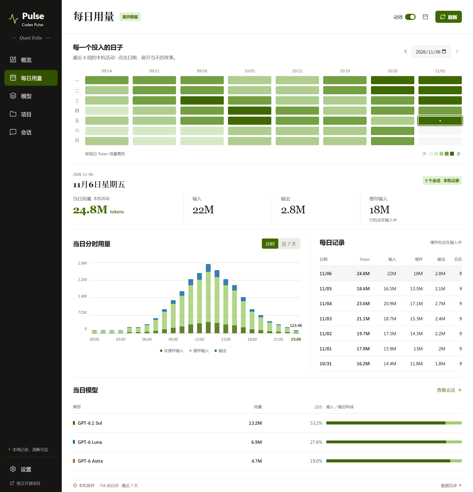
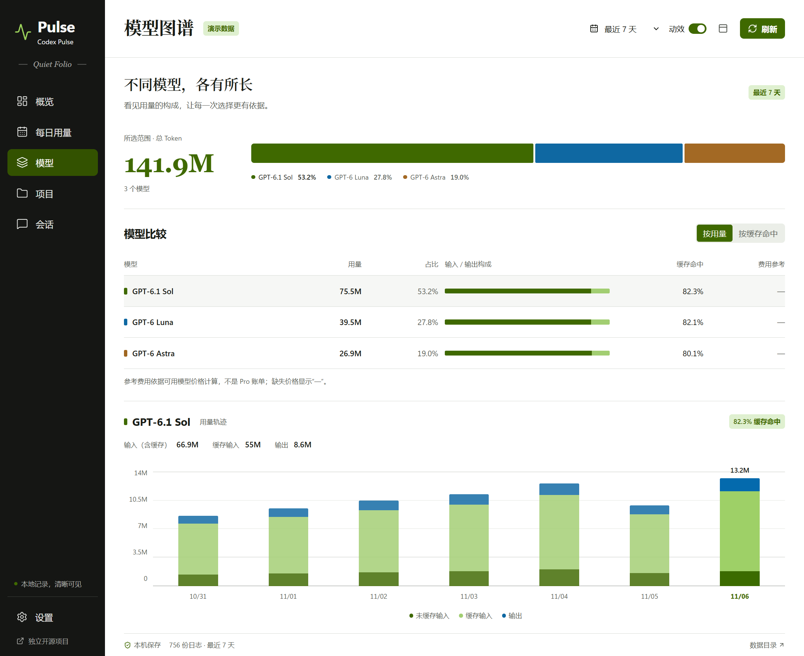
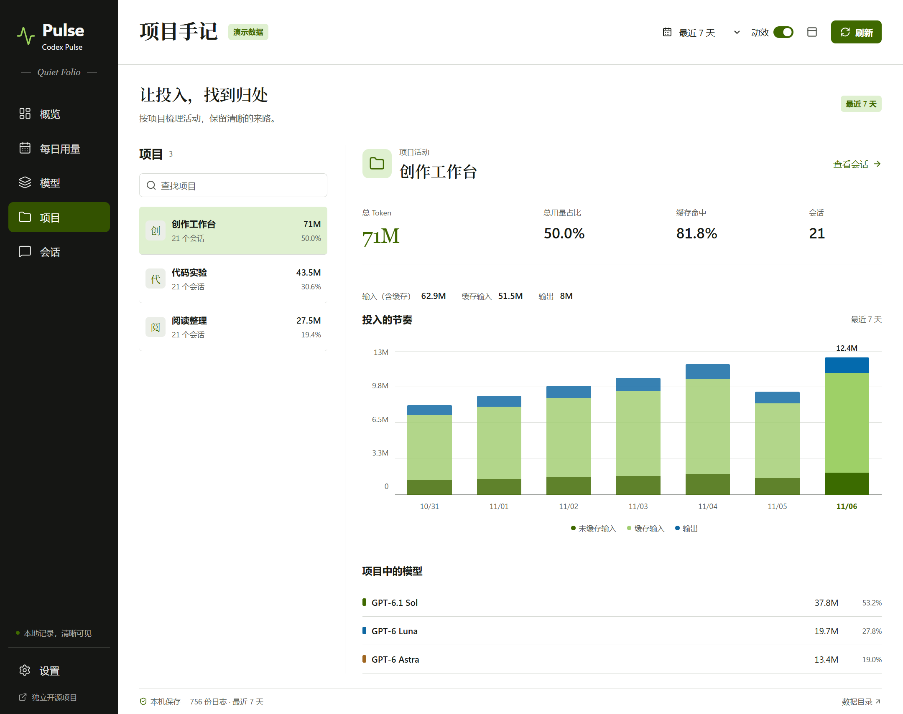
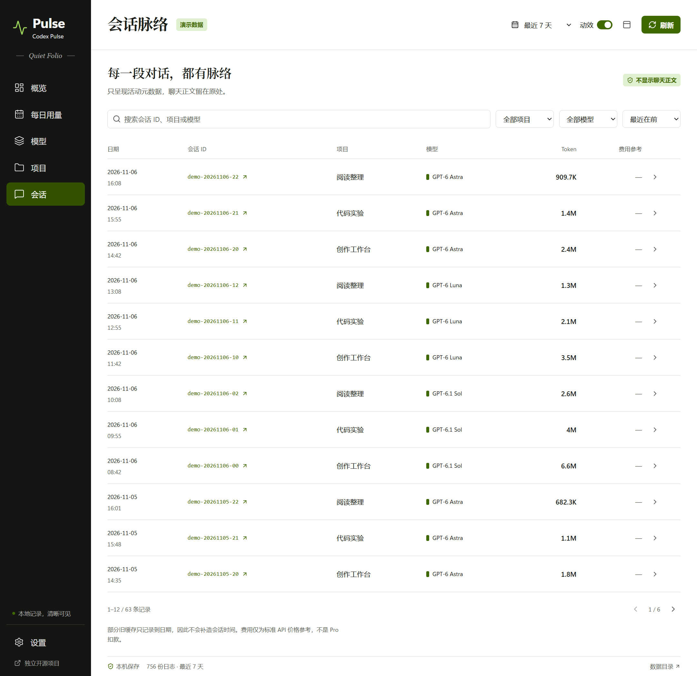
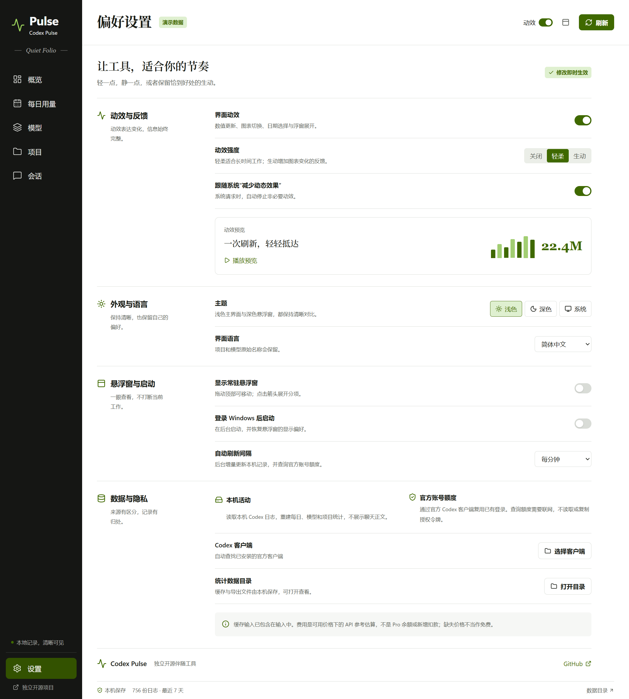

# Codex Pulse

在工作旁边看见用量，也能安静地读懂每一天。

**[English](README.md)** · [下载版本](https://github.com/zhulongqihan/codex-pulse/releases) · [在线体验](https://zhulongqihan.github.io/codex-pulse/) · [七页图集](https://zhulongqihan.github.io/codex-pulse/gallery.html) · [反馈问题](https://github.com/zhulongqihan/codex-pulse/issues)

用一个小悬浮窗查看还剩多少额度；需要了解消耗来自哪里时，再打开完整看板。Codex Pulse 把这两种使用方式放在一起，并清楚区分本机统计与官方账号数据。


> 所有截图均使用演示数据，不含真实账号信息。本项目独立开发，不隶属于 OpenAI，也不代表 OpenAI 官方产品。

## 能做什么

- **常驻悬浮窗**：放在工作窗口旁边，按需显示或隐藏，再进入看板查看明细。
- **每日历史**：从本机保留的 Codex 日志整理输入、缓存输入、输出和总 Token。
- **多种拆分**：按模型、项目和会话查看用量，不把对话正文变成信息流。
- **账号额度**：通过官方本地 app-server 复用现有 Codex 登录，读取账号返回的限额和重置时间。
- **可控制的动效**：在设置里关闭界面动画，并尊重系统的减少动态效果偏好。
- **数据保留在本机**：统计缓存与偏好存放在自己的电脑；Codex Pulse 不添加分析遥测。

## Windows 启动方法

1. 从 [Releases](https://github.com/zhulongqihan/codex-pulse/releases) 下载 Windows 便携 ZIP，对照发布页的校验文件检查 SHA256。
2. 完整解压到自己选择的可写目录。应用及随附文件需要放在一起。
3. 运行其中的程序。现有 Codex 保持通过 ChatGPT 登录即可，查询订阅额度不需要另填 API Key。

主窗口用于详细查看；悬浮窗可以在应用中显示或隐藏。进入 **按日** 查看某一天，进入 **模型 / 项目** 看消耗分布，在 **设置** 中调整动效与外观。某个数据源暂不可用时，另一来源的已有数据仍会保留显示。

账号查询失败不会把已有本机用量改成零。官方额度尚未返回时，会显示暂不可用，不编造数值；本机今日 Token 独立来自本地日志。

## 怎样理解这些数字

| 数据 | 来源 | 含义 |
|---|---|---|
| 每日和会话 Token | 本机会话日志 | 这台电脑仍保留的记录；已丢失或删除的日志无法凭空恢复 |
| 剩余额度和重置时间 | Codex 账号服务 | 当前登录账号与工作区实际返回的限额 |
| 界面中的费用估算 | 可获得的模型价格 | API 价格参考，**不是 Pro 账单、钱包余额或新增扣款** |

缓存输入已经包含在输入 Token 中，不能再加一次。账号额度可能包含其他设备的使用，因此本机 Token 总数不能直接换算为剩余百分比。

## 各个页面


<details>
<summary>展开查看按日、模型、项目、会话和设置</summary>

| 按日 | 模型 |
|---|---|
|  |  |
| 项目 | 会话 |
|  |  |



</details>

## 从源码运行

需要 Node.js 24 与 npm，将仓库放在自己选择的可写目录中：

```sh
git clone https://github.com/zhulongqihan/codex-pulse.git
cd codex-pulse
npm --cache .local/cache/npm install
npm run dev
```

构建正式版本：

```sh
npm test
npm run build
npm start
```

执行 `npm run package` 生成可分发文件。需要严格按锁文件安装时，使用 `npm --cache .local/cache/npm ci`。Windows 发行包在 Windows 上构建。

Electron 的 postinstall 包装器默认把下载和临时目录放进项目的 `.local`。npm 在 postinstall 前就会下载依赖，因此上面的命令也显式指定了 npm 缓存。等效地，可以在**第一次安装之前**设置仅对当前进程生效的路径，例如 PowerShell：

```powershell
$env:npm_config_cache = "$PWD\.local\cache\npm"
$env:ELECTRON_CACHE = "$PWD\.local\cache\electron"
$env:electron_config_cache = $env:ELECTRON_CACHE
$env:TEMP = "$PWD\.local\tmp"
$env:TMP = $env:TEMP
New-Item -ItemType Directory -Force $env:TEMP | Out-Null
npm ci
```

`.local` 已排除在 Git 之外。不要把私人导出文件或账号文件放进源码目录。

## 隐私和边界

Codex Pulse 读取 Codex 会话文件中的用量事件，并在支持的情况下包含保留的归档记录。原始 `.codex` 日志只读，仅写入应用自己的聚合缓存。不需要输入账号密码或复制 `auth.json`；登录状态及其刷新由 Codex 自己处理。

查询账号数据时，现有 Codex 客户端会连接 OpenAI。打开项目或版本页面属于用户主动打开外部链接。本机统计不代表已覆盖其他设备、所有云端任务或全部历史日志格式；Codex 日志格式和服务端能力也可能变化。

涉及私人信息的问题请先阅读 [SECURITY.md](SECURITY.md)；参与开发请看 [CONTRIBUTING.md](CONTRIBUTING.md)。CI 检查测试和构建，通过 CI 不等于已经完成独立安全审计或保证全部历史统计绝对精确。

## 灵感与许可

轻量用量伴随工具与详细本机看板的组合，受到 [ChatGPT-Usage](https://github.com/asetho/ChatGPT-Usage) 和 [Codex Usage Desktop](https://github.com/itvincent-git/codex-usage-desktop) 的启发。Codex Pulse 使用自己的实现与视觉标识，相关说明见 [THIRD_PARTY_NOTICES.md](THIRD_PARTY_NOTICES.md)。

使用 [MIT License](LICENSE) 开源。

参考费用仅在可获得本机参考价格缓存时显示；独立初装可能显示“未配置参考价格”。该估价不覆盖所有速度档位或工具费用。
